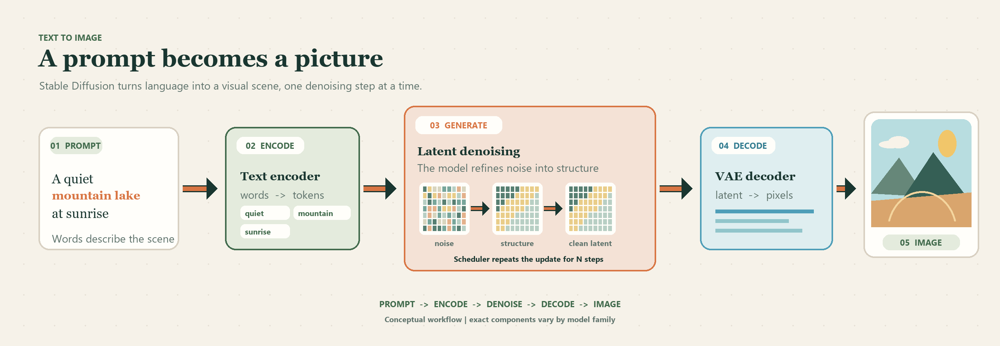
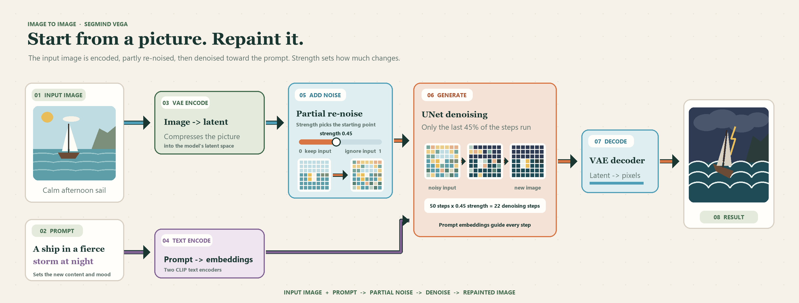
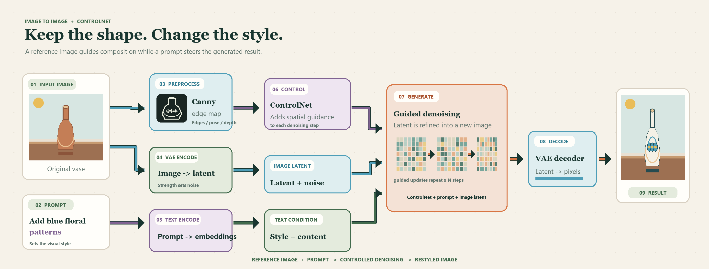

<div align="center">

# 🚀 AMD Stable Diffusion Sandbox

### High-Performance AI Stable Diffusion Image Generation on AMD Ryzen AI Hardware

[](LICENSE)
[](https://www.python.org/downloads/)
[](https://www.amd.com/en/products/ryzen-ai)
[](https://discord.gg/amd-dev)

</div>


---

## 📑 Contents
- **[🎯 What is This?](#-what-is-this)** - Overview and introduction
- **[📜 Supported Models](#-supported-models)** - List of supported SD models
- **[🏞️ Image Generation Methods](#️-image-generation-methods)** - Description of text-to-image, image-to-image, inpainting, removal, outpainting
- **[📐 Hardware Prerequisites](#-hardware-prerequisites)** - AMD hardware requirements (Strix and Medusa)
- **[🚀 Quick Start](#-quick-start)** - Installation process: get up and running
- **[🧩 Pipelines and Pipeline Groups Configuration](#-pipelines-and-pipeline-groups-configuration)** - Configure YAML and JSON files
- **[▶️ Running Pipelines](#️-running-pipelines)** - How to execute pipelines and pipeline groups
- **[🎨 Text-To-Image](#-text-to-image)** - Text-to-image parameters and dynamic resolution in detail
- **[� Image-To-Image Modes](#-image-to-image-modes)** - Strength-based and ControlNet image-to-image in detail
- **[�📤 Output](#-output)** - Generated images, results, and logs
- **[💬 Community & Support](#-community--support)** - Get help and connect

---

## 🎯 What is This?

**AMD SD Sandbox** is a framework for running Stable Diffusion (SD) models accelerated by **AMD Ryzen AI hardware**. It supports two NPU platforms, **Strix (STX)** and **Medusa (MDS)**, from a single codebase and this single README; wherever the two differ, the section is labeled by platform. **Medusa is a limited engagement and is not publicly available.** It provides an easy-to-use interface for evaluating, comparing, and deploying multiple SD pipelines. When developing AI-powered applications with SD, developers face several challenges:

| 🚫 Problem | ✅ Solution |
|-----------|------------|
| **Model Selection Complexity** - Dozens of SD models exist, each with different capabilities and tradeoffs, requiring separate tools and interfaces | **Unified Pipeline Interface** - Run any supported SD model with consistent commands and a single orchestration framework |
| **Hardware Optimization Guesswork** - Need to compare NPU vs GPU vs CPU performance to justify hardware investments and optimize deployments | **Built-in Performance Benchmarking** - Automated profiling with CPU baseline comparison to measure real acceleration gains with the NPU |
| **Tedious Manual Testing** - Testing multiple prompts across multiple models requires repetitive manual work and scattered results | **Automated Batch Processing** - Test hundreds of prompts across multiple models automatically with organized result management |
| **Code Modification Barriers** - Official examples require source code changes for simple customizations like prompts or resolution | **No-Code Customization** - Configure everything via YAML files and CLI arguments without adjusting source code |


The SD sandbox uses scripts to orchestrate GenAI-SD code distributed with Ryzen AI software. To use GenAI-SD without the orchestrator script please refer to the following: 
   [📚 GenAI-SD Documentation](#genai-sd-documentation)

---

## 📜 Supported Models

Here is a list of currently supported SD models. Note that these models have had nodes replaced with custom ops specifically designed for AMD NPUs. Models that aren't stored locally will be downloaded from Hugging Face on first use.

Models are published separately for each platform. Medusa models use a `-medusa` suffix on the Hugging Face model ID (e.g. `amd/sdxl-turbo-amdnpu-medusa`). The platform is detected automatically from the NPU hardware, and can be forced with the `NPU_PLATFORM` environment variable (`stx` or `mds`). If detection fails, a `-medusa` model ID selects Medusa; any other ID selects Strix.

These are the same NPU-optimized pipelines featured in the **[Ryzen AI Stable Diffusion Demo](https://ryzenai.docs.amd.com/en/latest/sd_demo.html#installation-steps)**. That demo is AMD's official preview, shipped with Ryzen AI software, of Stable Diffusion image generation running on Ryzen AI hardware. It shows how to drive each model directly from the `GenAI-SD` code — covering Text-to-Image, Image-to-Image, and ControlNet (Canny, Depth, Tile, Pose) plus SD3 inpainting (Strix only) — by calling the unified `run.py` entry point with a `--model_id`. This sandbox wraps those same pipelines in a configurable, batch-friendly orchestrator so you can run and benchmark many of them without editing source code.

The table below lists every model, with the Strix (RAI 1.8) and Medusa (MDS) Hugging Face model IDs side by side. Resolution and the Text-To-Image / Image-To-Image columns describe Strix (RAI 1.8). Anything that is different or unavailable on Medusa is called out in the last column and marked with ❌ (not available on MDS) or ⚠️ (limited on MDS).

| Model | Strix (RAI 1.8) Hugging Face Model ID | Medusa (MDS) Hugging Face Model ID | Default Resolution | Text-To-Image | Image-To-Image | Differences on MDS |
|-------|---------------------------------------|------------------------------------|--------------------|---------------|----------------|--------------------|
| SD 1.5 | [amd/stable-diffusion-1.5-amdnpu](https://huggingface.co/amd/stable-diffusion-1.5-amdnpu) | [amd/stable-diffusion-1.5-amdnpu-medusa](https://huggingface.co/amd/stable-diffusion-1.5-amdnpu-medusa) | 512x512 | ✅ | | |
| SD 1.5 ControlNet (Canny) | [amd/sd1.5-controlnet-canny-amdnpu](https://huggingface.co/amd/sd1.5-controlnet-canny-amdnpu) | ❌ | 512x512 | | ☑️ | ❌ **Not available on MDS** |
| SD Turbo | [amd/sd-turbo-amdnpu](https://huggingface.co/amd/sd-turbo-amdnpu) | ❌ | 512x512 | ✅ | | ❌ **Not available on MDS** |
| SD XL Turbo | [amd/sdxl-turbo-amdnpu](https://huggingface.co/amd/sdxl-turbo-amdnpu) | [amd/sdxl-turbo-amdnpu-medusa](https://huggingface.co/amd/sdxl-turbo-amdnpu-medusa) | 512x512, 5x DynRes | ✅ | | ⚠️ No DynRes in the shipped config (fixed 512x512) |
| SD XL Base | [amd/sdxl-base-amdnpu](https://huggingface.co/amd/sdxl-base-amdnpu) | [amd/sdxl-base-amdnpu-medusa](https://huggingface.co/amd/sdxl-base-amdnpu-medusa) | 1024x1024, 20x DynRes | ✅ | | ⚠️ No DynRes in the shipped config (fixed 1024x1024) |
| SSD-1B | [amd/SSD-1B-amdnpu](https://huggingface.co/amd/SSD-1B-amdnpu) | [amd/SSD-1B-amdnpu-medusa](https://huggingface.co/amd/SSD-1B-amdnpu-medusa) | 1024x1024, 20x DynRes | ✅ | | ⚠️ No DynRes in the shipped config (fixed 1024x1024) |
| Segmind Vega | [amd/segmind-vega-amdnpu](https://huggingface.co/amd/segmind-vega-amdnpu) | [amd/segmind-vega-amdnpu-medusa](https://huggingface.co/amd/segmind-vega-amdnpu-medusa) | 1024x1024 | ✅ | ☑️ | |
| Playground 2.5 | [amd/playground-v2.5-1024px-aesthetic-amdnpu](https://huggingface.co/amd/playground-v2.5-1024px-aesthetic-amdnpu) | [amd/playground-v2.5-1024px-aesthetic-amdnpu-medusa](https://huggingface.co/amd/playground-v2.5-1024px-aesthetic-amdnpu-medusa) | 1024x1024, 20x DynRes | ✅ | | ⚠️ No DynRes in the shipped config (fixed 1024x1024) |
| DreamShaper XL | [amd/dreamshaper-xl-lightning-amdnpu](https://huggingface.co/amd/dreamshaper-xl-lightning-amdnpu) | [amd/dreamshaper-xl-lightning-amdnpu-medusa](https://huggingface.co/amd/dreamshaper-xl-lightning-amdnpu-medusa) | 1024x1024, 20x DynRes | ✅ | | ⚠️ No DynRes in the shipped config (fixed 1024x1024) |
| SD 3.0 Medium — Text-to-Image, ControlNet (Canny, Depth, Tile, Pose), Inpainting | [amd/stable-diffusion-3-medium-amdnpu](https://huggingface.co/amd/stable-diffusion-3-medium-amdnpu) | ❌ | 512x512, 20x DynRes (Inpainting: 1024x1024) | ✅ | ☑️ | ❌ **Not available on MDS** |
| SD 3.5 Medium — Text-to-Image | [amd/stable-diffusion-3.5-medium-amdnpu](https://huggingface.co/amd/stable-diffusion-3.5-medium-amdnpu) | [amd/stable-diffusion-3.5-medium-amdnpu-medusa](https://huggingface.co/amd/stable-diffusion-3.5-medium-amdnpu-medusa) | 512x512, 20x DynRes | ✅ | | ⚠️ Fixed 1024x1024 unless dynamic shapes are enabled |
| FLUX.1 Schnell | [amd/FLUX.1-schnell-amdnpu](https://huggingface.co/amd/FLUX.1-schnell-amdnpu) | [amd/FLUX.1-schnell-amdnpu-medusa](https://huggingface.co/amd/FLUX.1-schnell-amdnpu-medusa) | 512x512, 20x DynRes | ✅ | | ⚠️ No DynRes in the shipped config (fixed 1024x1024) |
| FLUX.2 Klein | [amd/FLUX.2-klein-4B-amdnpu](https://huggingface.co/amd/FLUX.2-klein-4B-amdnpu) | [amd/FLUX.2-klein-4B-amdnpu-medusa](https://huggingface.co/amd/FLUX.2-klein-4B-amdnpu-medusa) | 1024x1024 | ✅ | | ➕ **MDS only:** Image-To-Image reference-image editing via `--edit_image_path` |

**DynRes** indicates the number of dynamic-resolution presets a model supports (e.g. `5x`, `20x`) in addition to its default resolution. The exact width×height pairs for each preset are defined in the `config/dynamic_shape_*.json` files — the 20x grid spans 512x288 – 1024x1024 across 1:1, 3:4, 4:3, 9:16, and 16:9 aspect ratios.

**Which config file?** Strix uses `config/pipeline_configs_strx.yaml` and Medusa uses `config/pipeline_configs_medusa.yaml`. Without `--config`, the file is chosen from the `NPU_PLATFORM` environment variable or the detected NPU, falling back to Strix if detection fails; pass `--config` to choose explicitly. See [Pipelines and Pipeline Groups Configuration](#-pipelines-and-pipeline-groups-configuration).

[Back to Table of Contents](#-contents)

---

## 🏞️ Image Generation Methods 

Here are some explanations of each of the SD methods. Note that pre- and post-processing padding and depadding are applied to the images where the resolutions do not match the model's inference resolution.

**🎨 Text-To-Image (T2I)** — Generate images from scratch using only text descriptions. Simply provide a prompt like "a mountain landscape at sunset" and the model creates a completely new image based on your description.
*Example use cases: concept art, marketing visuals, creative exploration, rapid prototyping*

See [Text-To-Image](#-text-to-image) for parameters and dynamic resolution.




<p align="center">• • •</p>

**🔄 Image-To-Image (I2I)** — Transform an existing image based on a text prompt while preserving certain structural or compositional elements. You provide both a reference image and a prompt, and the model generates a new image that follows the guidance of the input image while incorporating your text description.
*Example use cases: style transfer, image variations, artistic reinterpretation, photo enhancement*

Supported image-to-image modes:

- **Strength-based image-to-image** (Segmind Vega): repaints the input image itself; `strength` sets how much changes. See [Strength-Based Image-To-Image](#strength-based-image-to-image).
- **ControlNet image-to-image** (SD 3.0 Medium: Canny, Depth, Pose, Tile, InPainting; SD 1.5: Canny): keeps only the layout from a control image. See [ControlNet Image-To-Image](#controlnet-image-to-image).

> **FLUX.2 Klein image editing (Medusa only).** On Medusa, FLUX.2 Klein performs I2I as prompt-guided *image editing*: pass one or more reference images with `--edit_image_path`. With a single reference image you can restyle or alter it (e.g. *"Change the dress to red"*); with two reference images you can combine them (e.g. *"Replace the astronaut in image 1 with the girl in image 2"*). The `flux2_klein_i2i` (one image) and `flux2_klein_i2i_2` (two images) pipelines in `config/pipeline_configs_medusa.yaml` are examples.

---

## 📐 Hardware Prerequisites

Before getting started, make sure you meet the minimum hardware and OS requirements. **The requirements in the table below are for Strix (STX) only.**

> **Medusa (MDS) products are preview only.** Medusa is the new-generation Ryzen AI NPU platform, available only as a limited engagement and not publicly available. These Strix requirements do not apply to Medusa. Medusa uses the `-medusa` model variants and its own transaction plugins, and is selected automatically when a Medusa NPU is detected.

**Strix (STX) hardware requirements:**

| Series | Codename | Abbreviation | Graphics Model | Launch Year | Windows 11 | Linux |
|--------|----------|--------------|----------------|-------------------|-------------|---------|
| [Ryzen AI Max PRO 300 Series](https://www.amd.com/en/partner/articles/ryzen-ai-pro-300-series-processors.html) | Strix Halo | STX | Radeon 8000S Series | 2025 | ☑️ | |
| [Ryzen AI PRO 300 Series](https://www.amd.com/en/partner/articles/ryzen-ai-pro-300-series-processors.html) | Strix Point / Krackan Point | STX/KRK | Radeon 800M Series | 2025 | ☑️ | |
| [Ryzen AI Max 300 Series](https://www.amd.com/en/partner/articles/ryzen-ai-300-series-processors.html) | Strix Halo | STX | Radeon 8000S Series | 2025 | ☑️ | |
| [Ryzen AI 300 Series](https://www.amd.com/en/partner/articles/ryzen-ai-300-series-processors.html) | Strix Point | STX | Radeon 800M Series | 2025 | ☑️ | |

[Back to Table of Contents](#-contents)

---

## 🚀 Quick Start

#### Step 1: Install latest NPU Drivers and Ryzen AI SW

Follow the instructions here to download necessary NPU drivers and Ryzen AI SW: [Ryzen AI SW Installation Instructions](https://ryzenai.docs.amd.com/en/latest/inst.html). Please allow for around **5 minutes** to install all of the necessary components of Ryzen AI SW.

#### Step 2: Copy the Library Code

The binaries found in `GenAI-SD\lib` within the RAI installation directory is the only code needed to run the pipelines. Copy
the directory to the sandbox root. 

| Platform | Source directory |
|----------|------------------|
| Strix | `C:\Program Files\RyzenAI\1.9.0\GenAI-SD\lib` | 


#### Step 3: Configure Paths

Next, configure paths by editing [config/pipeline_configs_strx.yaml](config/pipeline_configs_strx.yaml) on Strix. Relative paths are resolved from the sandbox root. The bare minimum that you need to change in order to run a pipeline is:

1. `test_path` : the directory whose `generated_images` subfolder receives output images (and is emptied by `--clean-images`). Pipelines always run `test/run.py` from the sandbox root, regardless of `test_path`.

Optional paths that can be configured are:

2. `control_images_path`: the location of the `assets` directory in the `test` directory copied in Step 2. This is used for ControlNet pipelines that require control images. You can also specify a custom path here if desired.
3. `config_files_path`: the location of the `config` directory in the `GenAI-SD` directory copied in Step 2. This is used for dynamic shape configuration files used by SD3 pipelines. You can also specify a custom path here if desired.

```yaml
paths:
  test_path: "./test"
  control_images_path: "./test/assets"
  config_files_path: "./config"
```

More details on configurations can be found in the [Pipelines and Pipeline Groups Configuration](#-pipelines-and-pipeline-groups-configuration) section.

#### Step 4: Hugging Face Credentials

Supported models are downloaded from the Hugging Face Hub on first use, so you need to authenticate your machine with a Hugging Face access token.

1. Generate and copy a token from https://huggingface.co/settings/tokens. A token with **Read** access is sufficient to download the models. Some gated repos additionally require you to accept their license on the model page before the first download will succeed.
2. Log in from your terminal using the Hugging Face CLI (`hf`), which ships with the `huggingface_hub` package:
```powershell
hf auth login
```
Paste your token when prompted (or run it non-interactively with `hf auth login --token <YOUR_TOKEN>`). On success you should see, among other things:

```text
Login successful.
```

> **Note:** `hf auth login` is the current command and replaces the deprecated `huggingface-cli login`. For installation options (including running the CLI with `uv` via `uvx hf`, with no install), see the Hugging Face [CLI guide](https://huggingface.co/docs/huggingface_hub/en/guides/cli) and its [Using uv](https://huggingface.co/docs/huggingface_hub/en/guides/cli#using-uv) section.

#### Step 5: Activate RAI Conda Env

Activate the conda environment created during the Ryzen AI SW installation (Strix) or the MDS Software installation (Medusa)

```powershell
# Strix
conda activate ryzen-ai-1.8.0

# Medusa
conda activate ryzen-ai-ng-1.8.0
```
#### Step 6: Verify Installation

Verify that the main run script shows the possible pipelines and pipeline groups: 

```bash
# Strix (uses config/pipeline_configs_strx.yaml by default)
python scripts/run_pipelines.py --list

# Medusa
python scripts/run_pipelines.py --config config/pipeline_configs_medusa.yaml --list
```

You should see a list of all available pipelines and groups of pipelines for your platform, similar to this (Strix output shown; Medusa lists its own set of pipelines):
```text
[AUTO] Automatic provider selection (NPU > DML > CPU)

==================================================
Available Pipelines
==================================================
  sd_15                     - SD 1.5 Pipeline
  sd_turbo                  - SD Turbo Pipeline
  sdxl_base                 - SDXL Base Pipeline
  sdxl_turbo                - SDXL Turbo Pipeline
...

==================================================
Available Pipeline Groups
==================================================
  all                       - sd_15, sd_15_controlnet, sd_turbo, sdxl_turbo, sdxl_base, ...
...
```

You should now be able to run a pipeline with (on Medusa, add `--config config/pipeline_configs_medusa.yaml`):

```powershell
python scripts/run_pipelines.py --pipelines sd_15
```

And get an output similar to:

```text
[AUTO] Automatic provider selection (NPU > DML > CPU)

============================================================
Running 1 pipelines in QUICK TEST mode
============================================================

--- Pipeline 1/1: SD 1.5 Pipeline ---
     ---Loading ONNX Unet for DD
     2025-11-24 10:11:14,521 [INFO] Load unet/dd ...

...

     2025-11-24 10:11:44,580 [INFO] Total NPU memory usage: 1521.66MB (1.49GB)
[OK] SUCCESS in 36.5s
   [Dir] Images saved to: generated_images/

============================================================
SUMMARY - QUICK TEST MODE
============================================================
Total runs: 1
Successful: 1/1 (100.0%)
Total duration: 0:00:36.465767

Results saved to: C:\Users\User\bconsolv\sd-sandbox\results\pipeline_results_quick_20251124_101145.txt

```

[Back to Table of Contents](#-contents)

---

## 🧩 Pipelines and Pipeline Groups Configuration

Now that everything is installed, you are ready to configure and run SD pipelines. Pipelines are defined in a per-platform YAML configuration file, [config/pipeline_configs_strx.yaml](config/pipeline_configs_strx.yaml) for Strix and [config/pipeline_configs_medusa.yaml](config/pipeline_configs_medusa.yaml) for Medusa, and can be run via the main [scripts/run_pipelines.py](scripts/run_pipelines.py) script.

A pipeline is a complete SD workflow configuration that includes a specific model (e.g., SD 1.5, SDXL, SD 3.0), execution script, and parameters (resolution, inference steps, guidance scale). Each pipeline represents a single configured image generation setup, from text/image input to final image output.

Pipelines can be arranged into **groups** for common workflows (e.g., all SDXL models, all ControlNet models, etc.) to simplify running multiple pipelines at once. To create a pipeline group, simply list the desired pipelines under a group name in your platform's YAML configuration file.

### 📁 Config Directory

An overview of the directory structure that contains pipeline files and configurations is given below. The [config](config) directory contains two file types: [YAML](#yaml-files) and [JSON](#json-files).

#### YAML Files
YAML files define pipeline configurations, parameters, and execution settings. Here are the important YAML files:
- [config/pipeline_configs_strx.yaml](config/pipeline_configs_strx.yaml) - Strix configuration; used when `--config` is not given and a Strix NPU is detected (or detection fails)
- [config/pipeline_configs_medusa.yaml](config/pipeline_configs_medusa.yaml) - Medusa configuration; used when `--config` is not given and a Medusa NPU is detected, or select it with `--config`
- `pipeline_custom_config.yaml` - If not using the default, custom YAML files can be used with the `--config` argument as below:
```powershell
python scripts/run_pipelines.py --pipelines sd_15 --config pipeline_custom_config.yaml
```

**Choosing the configuration for your hardware.** Both configuration files use the same format. Pick the one that matches your hardware with the `--config` argument:

```powershell
# Strix (default)
python scripts/run_pipelines.py --pipelines sd_15

# Medusa
python scripts/run_pipelines.py --config config/pipeline_configs_medusa.yaml --pipelines sd_15
```

The Strix configuration defines every pipeline; the Medusa configuration defines a subset, plus two pipelines of its own. Pipelines marked ❌ are not available on MDS:

| Pipeline | Strix (`pipeline_configs_strx.yaml`) | Medusa (`pipeline_configs_medusa.yaml`) |
|---|---|---|
| `sd_15` | ✅ | ✅ |
| `sd_15_controlnet` | ✅ | ❌ **Not available on MDS** |
| `sd_turbo` | ✅ | ❌ **Not available on MDS** |
| `sdxl_turbo`, `sdxl_base`, `ssd_1b`, `playground_25`, `dreamshaper_xl` | ✅ | ✅ |
| `segmind_vega`, `segmind_vega_i2i` | ✅ | ✅ |
| `sd3_base` | ✅ | ❌ **Not available on MDS** |
| `sd3_controlnet_tile`, `sd3_controlnet_depth`, `sd3_controlnet_pose`, `sd3_controlnet_canny`, `sd3_controlnet_inpainting` | ✅ | ❌ **Not available on MDS** |
| `sd35_base` | ✅ | ✅ |
| `flux1_schnell`, `flux2_klein` | ✅ | ✅ |
| `flux2_klein_i2i`, `flux2_klein_i2i_2` | ❌ | ➕ **MDS only** |

Other differences between the two files:

| | Strix | Medusa |
|---|---|---|
| Model IDs | `amd/<model>-amdnpu` | `amd/<model>-amdnpu-medusa` |
| Pipeline groups | `all`, `flux` | `all`, `flux` |

The `flux2_klein_i2i` and `flux2_klein_i2i_2` pipelines exist only in the Medusa configuration. They use `edit_image_path` to pass one or two reference images to FLUX.2 Klein:

```yaml
  flux2_klein_i2i:
    name: "FLUX.2 Klein I2I Pipeline (1 image)"
    width: 1024
    height: 1024
    model_ids: ["amd/FLUX.2-klein-4B-amdnpu-medusa"]
    prompt: "Make the overalls red"
    args:
      edit_image_path: ["flux2_img3.png"]
      num_inference_steps: 4
      guidance_scale: 0.0

  flux2_klein_i2i_2:
    name: "FLUX.2 Klein I2I Pipeline (2 images)"
    width: 1024
    height: 1024
    model_ids: ["amd/FLUX.2-klein-4B-amdnpu-medusa"]
    prompt: "Put the man from img3 on the horse in img1"
    args:
      edit_image_path: ["flux2_img3.png", "flux2_img1.png"]
      num_inference_steps: 4
      guidance_scale: 0.0
```

Each configuration file has 3 main sections:
1. Global Pipeline Defaults
2. Pipeline Definitions
3. Pipeline Groups

**1. Global Pipeline Defaults**

Global defaults are defined at the top of the YAML file and are useful for setting parameters that apply to all pipelines, such as the output image resolution, or an external prompt file. The global defaults can always be overridden on a per-pipeline basis, by making a change to a variable in the pipeline definition.  

One example of setting a global default might be setting the `num_inference_steps` to 20 with `default_args: ["--num_inference_steps", "20"]` under `defaults`. Every pipeline will use 20 inference steps unless overridden in the pipeline's `args`. Only `width`, `height`, `prompt`, `prompt_file`, `image_only`, `streaming_output`, `execution`, and `default_args` are read from `defaults`; other runner parameters such as `guidance_scale` must go in `default_args`.

Under `paths`, `test_path` sets where generated images are saved (`<test_path>/generated_images`); `run.py` is always launched from the sandbox's `test` directory. `models_path` is optional and defaults to `models`. A global `prompt_file` under `defaults` is optional; without it, each pipeline's `prompt` (or the global `prompt`) is used.

**2. Pipeline Definitions**

Pipelines are defined in the YAML configuration file under the `pipelines` section. Each pipeline has its own set of parameters that can override the global defaults. A pipeline definition uses the following keys:

1. A unique pipeline identifier (e.g., `sd_15`, `sdxl_turbo`). **(required)**
2. `name` — a human-readable display name (e.g., `"SD 1.5 Pipeline"`). **(required)**
3. `model_ids` — a **list** of one or more Hugging Face model IDs or local model folder names (e.g., `["amd/stable-diffusion-1.5-amdnpu"]`). **(required)**
4. `args` — a dictionary of model/runner parameters such as resolution, inference steps, and guidance scale.

> **🆕 New in RAI 1.8 — Unified entry point.** All pipelines now run through a single unified script, `run.py`. The previous per-model scripts (`run_sd.py`, `run_sd_xl.py`, `run_sd3.py`) have been consolidated, so you no longer specify a `script` for each pipeline — `run.py` is selected automatically. A `script` key is still accepted for advanced overrides but is rarely needed.

A minimal pipeline definition looks like this:

```yaml
  sd_15:
    name: "SD 1.5 Pipeline"
    model_ids: ["amd/stable-diffusion-1.5-amdnpu"]
    args:
      num_inference_steps: 20
```

If nothing else is specified, default values are used. Almost all hyperparameters can be overridden on a per-pipeline basis.

To see all available runner parameters, run `--help` on the unified entry point in the `test` directory:

```powershell
python test/run.py --help
```

**🆕 New in RAI 1.8 — the `args` dictionary (recommended)**

Pipeline parameters are now set using an `args` dictionary of `key: value` pairs. This replaces the older flat `extra_args` list. Each entry is converted to a `--key value` command-line flag automatically:

| YAML `args` value type | Example | Resulting CLI flag |
|------------------------|---------|--------------------|
| string / number | `num_inference_steps: 20` | `--num_inference_steps 20` |
| boolean `true` | `dynamic_shape: true` | `--dynamic_shape` (bare flag) |
| boolean `false` | `dynamic_shape: false` | *(omitted)* |
| list | `image_pads: [0, 64, 0, 64]` | `--image_pads 0 64 0 64` |

For example, a fully configured SD3 pipeline (Strix only; SD 3.0 is not available on Medusa, which defines `sd35_base` instead):

```yaml
  sd3_base:
    name: "SD3 Pipeline"
    model_ids: ["amd/stable-diffusion-3-medium-amdnpu"]
    args:
      num_inference_steps: 30
      width: 1024
      height: 1024
      controlnet: "None"
      guidance_scale: 4.5
      dynamic_shape: true
```

> **Note:** The legacy `extra_args` list (e.g. `extra_args: ["--num_inference_steps", "20"]`) is still supported for backward compatibility. If both `args` and `extra_args` are present, the `args` entries are applied first.

Pipeline configurations are validated against the known set of runner arguments before each run, so unknown keys and out-of-range values are caught early with a clear warning rather than failing mid-run.

The **best** way to become familiar with the available parameters is to examine the [Strix](config/pipeline_configs_strx.yaml) or [Medusa](config/pipeline_configs_medusa.yaml) configuration file. 

**Dynamic resolution**: `dynamic_shape` and `dynamic_shape_file_path` let one model generate several resolutions without recompilation. See [Dynamic Resolution](#dynamic-resolution).

**3. Pipeline Groups**

For convenience, you can organize pipelines into **groups** for common workflows. A pipeline group is created by creating a unique group name and listing the desired pipelines under that group in the YAML file. 

For example, the `all_sdxl` tests all SDXL models:

```yaml
  all_sdxl:
    - sdxl_base
    - sdxl_turbo
    - ssd_1b
```

To run this pipeline group, you can run with the `--pipeline_groups` command as follows:

```powershell
python scripts/run_pipelines.py --pipeline_groups all_sdxl
```

You can also create your own pipeline groups by modifying the YAML file under `pipeline_groups` to specify which pipelines you would like to run:

```yaml
pipeline_groups:
  my_custom_pipeline_group: #group identifier
    - sd_turbo
    - sdxl_turbo
```

#### JSON Files
Each JSON file contains an array of text prompts passed sequentially to pipelines for batch testing. The example JSON files can be found here:
- [config/artistic_prompts.json](config/artistic_prompts.json), [config/anime_prompts.json](config/anime_prompts.json), [config/alt_prompts.json](config/alt_prompts.json) - Themed prompt collections
- `custom_prompts.json` - Your own custom prompt file
You can pass your own list of prompts with the `--prompt_file` argument. For example:

```powershell
python scripts/run_pipelines.py --pipelines sd_15 --prompt_file custom_prompts.json
```

[Back to Table of Contents](#-contents)

---

## ▶️ Running Pipelines

Pipelines are run by invoking the [scripts/run_pipelines.py](scripts/run_pipelines.py) with the desired pipeline or pipeline group specified. For example, we can run the `sd_15` pipeline with:

```powershell
python scripts/run_pipelines.py --pipelines sd_15
```

Or we can run the `all` pipelines group with: 

```powershell
python scripts/run_pipelines.py --pipeline_groups all
```

A full list of pipeline parameters and their descriptions can be found by running `--help` on the main script:

```powershell
python scripts/run_pipelines.py --help
```

### Execution Modes

The framework has three execution modes. They differ only in how many times each prompt is generated and how much timing information is reported. In every mode, **one image is saved per prompt and resolution**.

| Mode | Generations per prompt | Timing reported | Image filename tag | Results file |
|------|------------------------|-----------------|--------------------|--------------|
| **Image-Only** | 1 | Model load summary and a single pipeline execution time (includes first-run overhead) | `batch` | `pipeline_results_image_only_*.txt` |
| **Quick Test** | 2 (1 warmup + 1 profiled) | Model load summary, warmup (1st gen) time, average pipeline time, per-component times, memory | `profiling` | `pipeline_results_quick_*.txt` |
| **Benchmark** | 11 (1 warmup + 10 profiled) | Same as Quick Test, averaged over 10 rounds | `profiling` | `pipeline_results_benchmark_*.txt` |

The saved image always comes from the first generation; the profiled rounds are used for timing only. If a run mixes Image-Only and Quick Test pipelines (see [Setting the mode per pipeline](#setting-the-mode-per-pipeline)), the results file is named `pipeline_results_mixed_*.txt`. Log files saved with `--save-log` use the same mode in their name (e.g. `pipeline_log_quick_test_*.txt`).

**Quick Test Mode is the default** on both Strix and Medusa; neither shipped configuration enables `image_only`. The mode for each pipeline is chosen in this order (highest first):

1. `--benchmark` — always Benchmark Mode, regardless of any `image_only` setting
2. `--image-only` — Image-Only Mode for every pipeline
3. `image_only` set on the pipeline in the YAML
4. `image_only` under `defaults` in the YAML
5. Otherwise, Quick Test Mode

#### 1. Image-Only Mode

Use this for generating images as fast as possible, e.g. batch-generating images from a prompt file. Each prompt is generated once with no warmup or profiling.

```powershell
# Strix
python scripts/run_pipelines.py --image-only --pipelines sd3_base --prompt_file config/anime_prompts.json

# Medusa
python scripts/run_pipelines.py --config config/pipeline_configs_medusa.yaml --image-only --pipelines sd35_base --prompt_file config/anime_prompts.json
```
*Output: 5 images (`anime_prompts.json` contains 5 prompts), no profiling metrics*

To make Image-Only the default for every pipeline without passing `--image-only`, set `image_only: true` under `defaults` in the YAML.

#### 2. Quick Test Mode

Use this for a quick performance check. Each prompt is generated once as a warmup and once more for profiling, so the report separates the first-generation time from the steady-state time.

```powershell
# Strix
python scripts/run_pipelines.py --pipelines sdxl_turbo

# Medusa
python scripts/run_pipelines.py --config config/pipeline_configs_medusa.yaml --pipelines sdxl_turbo
```
*Output: 1 image per prompt, warmup and average timing statistics*

#### 3. Benchmark Mode

Use this for performance measurement. Each prompt is generated once as a warmup, followed by 10 profiled rounds whose times are averaged. Benchmark Mode works the same on both platforms and needs no YAML changes.

```powershell
# Strix
python scripts/run_pipelines.py --benchmark --pipelines sdxl_turbo

# Medusa
python scripts/run_pipelines.py --config config/pipeline_configs_medusa.yaml --benchmark --pipelines sdxl_turbo
```
*Output: 1 image per prompt, timing averaged over 10 rounds.* The log shows `Running 10 profiling rounds...` followed by `__ROUND_COMPLETE__ 1/10` … `10/10`. Benchmark results files can be converted to CSV; see [Benchmark Files](#benchmark-files).

#### Setting the mode per pipeline

Add a top-level `image_only` key to a pipeline definition (next to `name` and `model_ids`, not inside `args`) to override the `defaults` value for that pipeline only. For example, to profile every pipeline except FLUX.1 Schnell, which only generates images:

```yaml
defaults:
  image_only: false

pipelines:
  flux1_schnell:
    name: "FLUX.1 Schnell Pipeline"
    image_only: true
    model_ids: ["amd/FLUX.1-schnell-amdnpu"]
    args:
      num_inference_steps: 4
```

The reverse also works: set `image_only: true` under `defaults` and `image_only: false` on the pipelines you want to profile. `--image-only` and `--benchmark` on the command line override per-pipeline settings.

### Argument priority 

The framework support argument priorities based on the following order (highest to lowest): 
1. Command-line arguments
2. Pipeline-specific YAML config
3. Global YAML defaults
4. Script-level defaults

### Pipeline Options

The following are framework-level options that can be passed at the command line, or set in the YAML configuration file. Please **read** this carefully as it describes all of the available options for running pipelines. You can run the `--help` argument to get the same information at the command line:

```powershell
python scripts/run_pipelines.py --help
```

| Option | Type | Default | Help |
|--------|------|---------|------|
| --benchmark | flag | False | Enable benchmark mode (10 profiling rounds). Default is quick mode (1 round). |
| --image-only | flag | False | Generate images only without profiling (batch mode). Disables warmup and profiling rounds for fastest execution. Overrides `image_only` in the YAML. `--benchmark` takes precedence over `--image-only`. |
| --timeout | int | 600 | Timeout in seconds for each run (default: 600) |
| --model_id | list |  | Accepted but not currently used to filter pipelines; use `--pipelines` or `--pipeline_groups` instead |
| --pipelines | list |  | Run specific pipelines by name (e.g. --pipelines sd_15 sd3_base) |
| --pipeline_groups | list |  | Run pipeline groups (e.g. --pipeline_groups all_sd3 quick_test) |
| --list | flag | False | List available pipelines and groups, then exit |
| --prompt | str |  | Custom prompt to use for all pipelines |
| --prompt_file | str |  | Path to JSON file containing list of prompts to run through each pipeline |
| --sd3-controlnet-mode | str | controlnet | For SD3 ControlNet with prompt files: 'controlnet' uses custom prompts with ControlNet enabled (recommended), 'text2img' converts to text-to-image mode without ControlNet guidance (default: controlnet) |
| --force-cpu | flag | False | Force CPU-only execution (disables DML and all accelerators). Overrides config setting. |
| --no-summary | flag | False | Skip printing the detailed summary report and skip saving results to disk |
| --config | str | auto-detected | Path to custom YAML configuration file (default: config/pipeline_configs_medusa.yaml or config/pipeline_configs_strx.yaml, chosen from `NPU_PLATFORM` or the detected NPU; Strix if undetected) |
| --clean-images | flag | False | Remove all existing images and Excel files from generated_images folder before running pipelines |
| --clean-results | flag | False | Remove all existing result files from results folder before running pipelines |
| --save-log | flag | False | Save complete log output to a text file when any pipeline has streaming output enabled |
| --traceback | flag | False | Include full traceback in error messages for detailed debugging |

[Back to Table of Contents](#-contents)

---

## 🎨 Text-To-Image

This section details text-to-image generation, listed under [Image Generation Methods](#️-image-generation-methods).

### How It Works

Generation starts from random noise set by `seed`. The text encoders turn the prompt into embeddings, the denoiser removes the noise over `num_inference_steps` steps while following those embeddings, and the VAE decoder turns the result into an image. The denoiser is a UNet for SD 1.5 and the SDXL family, and a transformer for SD3, SD3.5 and FLUX. The denoiser and VAE decoder run on the NPU; the tokenizers and text encoders run on the CPU or GPU, as shown in the model load summary of each run.

Every pipeline without a `control_image_path`, `controlnet` type or `edit_image_path` is a text-to-image pipeline. A minimal one needs only a model and a prompt:

```yaml
  sdxl_base:
    name: "SDXL Base Pipeline"
    width: 1024
    height: 1024
    model_ids: ["amd/sdxl-base-amdnpu"]
    prompt: "A cozy cabin by a mountain lake in autumn, golden hour lighting"
    args:
      num_inference_steps: 30
```

```powershell
python scripts/run_pipelines.py --pipelines sdxl_base
```

### Key Parameters

| Parameter | Where to set it | Effect |
|-----------|-----------------|--------|
| `prompt` | Pipeline (next to `name`), `defaults`, `--prompt`, or `--prompt_file` | What to generate |
| `n_prompt` | `args` | What to avoid, e.g. `"blurry, low quality, watermark, text"` |
| `num_inference_steps` | `args` | Number of denoising steps. More steps take longer; distilled models (Turbo, Lightning, Schnell, Klein) are built for very few |
| `guidance_scale` | `args` | How strictly the prompt is followed. Distilled models use `0.0` |
| `width`, `height` | Pipeline, `defaults`, or `args` | Output resolution. Must be a resolution the model supports; see [Dynamic Resolution](#dynamic-resolution) |
| `seed` | `args` | Random seed. The same seed and settings give the same image |
| `num_images_per_prompt` | `args` | Images generated per prompt |

The shipped Strix text-to-image pipelines use these settings (blank guidance = model default):

| Pipeline | Steps | `guidance_scale` | Default resolution | Dynamic resolution |
|----------|-------|------------------|--------------------|--------------------|
| `sd_15` | 20 | | 512x512 | ❌ |
| `sd_turbo` | 1 | 0.0 | 512x512 | ❌ |
| `sdxl_turbo` | 4 | 0.0 | 512x512 | 5 shapes |
| `sdxl_base` | 30 | | 1024x1024 | 20 shapes |
| `ssd_1b` | 30 | | 1024x1024 | 20 shapes |
| `playground_25` | 30 | | 1024x1024 | 20 shapes |
| `dreamshaper_xl` | 6 | | 1024x1024 | 20 shapes |
| `segmind_vega` | 50 | | 1024x1024 | ❌ |
| `sd3_base` | 30 | 4.5 | 1024x1024 | 20 shapes |
| `sd35_base` | 30 | 4.5 | 1024x1024 | 20 shapes |
| `flux1_schnell` | 4 | 0.0 | 1024x1024 | 20 shapes |
| `flux2_klein` | 4 | 0.0 | 1024x1024 | ❌ |

### Dynamic Resolution

Models with dynamic resolution (DynRes) can generate several resolutions and aspect ratios from one set of compiled NPU models, with no recompilation. The supported resolutions for each model are listed in a shape file:

| Shape file | Used by | Resolutions |
|------------|---------|-------------|
| [config/dynamic_shape_5x.json](config/dynamic_shape_5x.json) | SDXL Turbo | 512x512, 384x512, 512x384, 288x512, 512x288 |
| [config/dynamic_shape_20x.json](config/dynamic_shape_20x.json) | SDXL Base, SSD-1B, Playground 2.5, DreamShaper XL, SD3, SD3.5, FLUX.1 Schnell | 20 sizes from 512x288 to 1024x1024 in 1:1, 3:4, 4:3, 9:16 and 16:9 |

Each entry gives a `height` and `width`. Any other keys in an entry (such as `t5_sequence_len`) are passed to the pipeline for that resolution.

Two `args` keys control dynamic resolution:

| `dynamic_shape` | `dynamic_shape_file_path` | Result |
|-----------------|---------------------------|--------|
| `true` | not set | One resolution: the pipeline's `width` and `height` |
| `true` | set | Every resolution in the shape file, in order |
| `false` / not set | ignored | One resolution: the pipeline's `width` and `height` |

**One non-square resolution.** Set `dynamic_shape: true` and pick a `width` and `height` from the model's shape file:

```yaml
  sdxl_base_portrait:
    name: "SDXL Base Portrait"
    width: 768
    height: 1024
    model_ids: ["amd/sdxl-base-amdnpu"]
    args:
      num_inference_steps: 30
      dynamic_shape: true
```

**Every resolution.** Add `dynamic_shape_file_path`. Relative paths are resolved from `config_files_path` (`./config` by default):

```yaml
  flux1_schnell_all_sizes:
    name: "FLUX.1 Schnell - All Sizes"
    model_ids: ["amd/FLUX.1-schnell-amdnpu"]
    args:
      num_inference_steps: 4
      guidance_scale: 0.0
      dynamic_shape: true
      dynamic_shape_file_path: "dynamic_shape_20x.json"
```

One image is saved per prompt and resolution, so a 20-shape file with a 5-prompt file produces 100 images. Each filename contains its resolution (e.g. `..._768x1024_steps4_...png`). The results file reports only the pipeline's configured `width`x`height`, so check the filenames or the `Using resolutions from` log line to see which shapes ran.

**Notes:**
- Use only resolutions from the model's shape file. SDXL Turbo supports up to 512x512 only.
- SD 1.5, SD Turbo, Segmind Vega and FLUX.2 Klein do not support dynamic resolution and run at their default resolution.
- SD3 ControlNet Inpainting is fixed at 1024x1024.
- **Medusa:** the shipped Medusa configuration runs every model at a fixed resolution. SD3.5 can generate the 20 resolutions above by adding `dynamic_shape: true` and `dynamic_shape_file_path: "dynamic_shape_20x.json"` to its `args`.

**Checking every resolution.** [config/pipeline_configs_dynres_smoke.yaml](config/pipeline_configs_dynres_smoke.yaml) runs each Strix DynRes model across its full shape file with 1 inference step and no image output. A pipeline passes only if every resolution completes:

```powershell
# All DynRes models
python scripts/run_pipelines.py --config config/pipeline_configs_dynres_smoke.yaml --pipeline_groups dynres_smoke

# One model
python scripts/run_pipelines.py --config config/pipeline_configs_dynres_smoke.yaml --pipelines dynres_sdxl_turbo
```

[Back to Table of Contents](#-contents)

---

## � Image-To-Image Modes

This section details the image-to-image modes listed under [Image Generation Methods](#️-image-generation-methods).

### Strength-Based Image-To-Image

Used by **Segmind Vega**. The input image is encoded into the model's latent space, partly re-noised, then denoised toward the prompt. `strength` (0–1) sets how much of the image is replaced: near 0 keeps the input almost unchanged, near 1 ignores it. Only the last `strength` × `num_inference_steps` denoising steps run, so the shipped `segmind_vega_i2i` pipeline (50 steps, strength 0.45) runs 22 steps.



Segmind Vega switches to image-to-image when `control_image_path` is set; no ControlNet is involved. The shipped pipeline repaints `outpainting_output_1024x1024.png` at 1024x1024:

```yaml
  segmind_vega_i2i:
    name: "Segmind-Vega I2I Pipeline"
    model_ids: ["amd/segmind-vega-amdnpu"]
    args:
      num_inference_steps: 50
      control_image_path: "outpainting_output_1024x1024.png"
      strength: 0.45
      guidance_scale: 7.0
```

```powershell
python scripts/run_pipelines.py --pipelines segmind_vega_i2i
```

### ControlNet Image-To-Image

Guide generation with a *control image* that fixes the layout of the result, such as an edge map, depth map, pose skeleton or masked photo. The ControlNet keeps the composition from the control image while the prompt decides the content and style. `controlnet_conditioning_scale` sets how strongly the control image is followed.
*Example use cases: keeping a product's shape while changing its style, posing characters, replacing an object in a photo*



ControlNet is available for SD 3.0 Medium and SD 1.5 (Strix only). Set the type with `controlnet` and the control image with `control_image_path` in the pipeline's `args`. Relative image paths are resolved from `control_images_path` (`test/assets` by default).

| Pipeline | Model | `controlnet` | Control image | Example asset | Conditioning scale |
|----------|-------|--------------|---------------|---------------|--------------------|
| `sd3_controlnet_canny` | SD 3.0 Medium | `Canny` | Edge map (white lines on black) | `control.png` | 0.7 |
| `sd3_controlnet_depth` | SD 3.0 Medium | `Depth` | Depth map (near = bright) | `depth.jpeg` | 0.8 |
| `sd3_controlnet_pose` | SD 3.0 Medium | `Pose` | OpenPose skeleton | `pose.jpg` | 0.7 |
| `sd3_controlnet_tile` | SD 3.0 Medium | `Tile` | Regular photo whose detail and structure are kept | `tile.jpg` | 0.65 |
| `sd3_controlnet_inpainting` | SD 3.0 Medium | `InPainting` | Photo plus a mask in `control_mask_path` (white = regenerate, black = keep) | `coffee_table.png` + `precise_mask.png` | 0.85 |
| `sd_15_controlnet` | SD 1.5 ControlNet | `Canny` (fixed) | Regular photo; Canny edges are extracted automatically | `test/ref/control.png` (model default) | 1.5 |

**Preparing control images:** SD3 ControlNet uses the control image as-is, so Canny, Depth and Pose inputs must already be an edge map, depth map or pose skeleton. SD 1.5 ControlNet takes an ordinary photo and computes the Canny edge map itself. SD3 ControlNet pipelines run at 1024x1024.

Run a ControlNet pipeline like any other pipeline:

```powershell
python scripts/run_pipelines.py --pipelines sd3_controlnet_depth
```

[Back to Table of Contents](#-contents)

---

## �📤 Output

When running [scripts/run_pipelines.py](scripts/run_pipelines.py), the outputs are images and result text files in specific locations with organized naming conventions.

### Generated Images

Images by default can be found in `test/generated_images/`. Filenames include model name, image index, run type, resolution, number of steps, prompt index, and timestamp (e.g., `test/generated_images/FLUX.1-schnell-amdnpu_img0_batch_1024x1024_steps4_prompt0_20261012_121816.png`).

> **Note:** You can use the `--clean-images` flag to remove all existing images from the `generated_images` folder before running any pipelines. 

### Results Text Files

Results files can be found in `results/` directory (e.g., `results/pipeline_results_quick_20251124_100116.txt`). They contain execution status (success/failure), duration, timing data, model information, resolution, and error messages for all pipelines run in a session.

> **Note:** You can disable the generation of summary files by using the `--no-summary` flag when running the main script. You can also use the `--clean-results` flag to remove all existing result files from the `results` folder before running any pipelines.

### Log Files

You can choose to save all lines printed to the console at runtime with the`--save-log` flag when running the main script. Log files are saved in the `results/` directory and contain the complete console output from all pipeline executions, including detailed progress messages, warnings, and debug information (e.g., `results\pipeline_log_quick_test_20251124_102713.txt`).

### Benchmark Files

When using the benchmarking mode (`--benchmark`), the results text file includes the benchmarking information (e.g., `results/pipeline_results_benchmark_20251124_102713.txt`). 

After creating the `pipeline_results_benchmark_*.txt` files, you can run the [scripts/process_benchmark_results.py](scripts/process_benchmark_results.py) script to extract benchmark data. This CSV can be imported into Excel for performance analysis and comparison. To generate the CSV file, simply run:

```powershell
python scripts/process_benchmark_results.py
```

And you should get an output of CSV files (e.g., `benchmark_summary_20251124_104406.csv`) with an output similar to:

```csv
Model Name,Resolution,Inference Steps,NPU Models Load Time (s),All Models Load Time (s),1st Gen Pipeline Time (s),Avg Pipeline Time (s),Seconds/Iter,NPU Memory Usage (MB),Total Memory Usage (MB)
SD 1.5 Pipeline,512x512,20,3.898902,3.899352,5.979673,5.978549,0.298927,1527.36,4412.52
```

[Back to Table of Contents](#-contents)

---

## GenAI-SD Documentation

These guides come from the `GenAI-SD` folder shipped with the **Ryzen AI 1.8 software installer** (`C:\Program Files\RyzenAI\1.8.0\GenAI-SD`) for Strix, or the MDS software installer (`C:\Program Files\RyzenAI\ng-1.8.0\GenAI-SD`) for Medusa — the same folder you copy in [Step 2](#step-2-copy-genai-sd-code). They describe how to use the GenAI-SD code **directly** — without this sandbox's orchestrator — covering driver and conda setup, the per-model `run.py` commands, troubleshooting, and more. Once you've copied that folder locally you can follow these documents in it; the copies below are mirrored in this repository's [`docs/`](docs) directory for convenience.

| Document | Contents |
|----------|----------|
| [docs/01-quick-start.md](docs/01-quick-start.md) | Driver installation, conda setup, first run |
| [docs/02-user-guide.md](docs/02-user-guide.md) | Batch pipelines, YAML config, execution modes |
| [docs/03-model-reference-guide.md](docs/03-model-reference-guide.md) | All model commands and CLI arguments |
| [docs/04-model-generate-guide.md](docs/04-model-generate-guide.md) | DD model creation workflow (`onnx_utils`, Windows only) |
| [docs/05-linux-guide.md](docs/05-linux-guide.md) | Linux setup |
| [docs/06-faq.md](docs/06-faq.md) | Top 15 failure modes and solutions |
| [docs/07-developer-guide.md](docs/07-developer-guide.md) | Adding new pipelines to the codebase |
| [docs/08-glossary.md](docs/08-glossary.md) | NPU, DD, ControlNet, InPainting, and more |

[Back to Table of Contents](#-contents)

---

## 💬 Community & Support

<div align="center">

[](https://discord.gg/amd-dev)

</div>

- **AMD Ryzen AI Documentation**: [https://ryzenai.docs.amd.com/](https://ryzenai.docs.amd.com/)
- **AMD Driver Support Portal**: [https://www.amd.com/en/support](https://www.amd.com/en/support)

[Back to Table of Contents](#-contents)

---

<div align="center">

**⭐ If this framework helped your development, consider starring the repository! ⭐**

*Built with ❤️ by AMD for the AI developer community*

</div>

[Back to Table of Contents](#-contents)


---

## License

© 2024–2026 Advanced Micro Devices, Inc. See [LICENSE](LICENSE).

