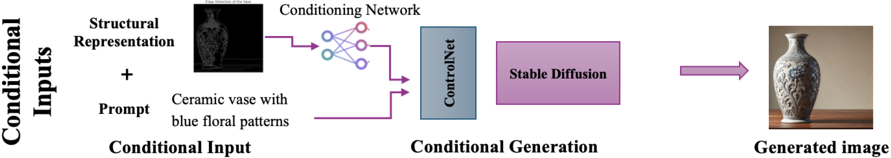

<div align="center">

# 🚀 AMD Stable Diffusion Sandbox

### High-Performance AI Stable Diffusion Image Generation on AMD Ryzen AI Hardware

[](LICENSE)
[](https://www.python.org/downloads/)
[](https://www.amd.com/en/products/ryzen-ai)
[](https://discord.gg/amd-dev)

</div>


---

## 📑 Contents
- **[🎯 What is This?](#-what-is-this)** - Overview and introduction
- **[📜 Supported Models](#-supported-models)** - List of supported SD models
- **[🏞️ Image Generation Methods](#️-image-generation-methods)** - Description of text-to-image, image-to-image, inpainting, removal, outpainting
- **[📐 Hardware Prerequisites](#-hardware-prerequisites)** - AMD hardware requirements
- **[🚀 Quick Start](#-quick-start)** - Installation process: get up and running
- **[🧩 Pipelines and Pipeline Groups Configuration](#-pipelines-and-pipeline-groups-configuration)** - Configure YAML and JSON files
- **[▶️ Running Pipelines](#️-running-pipelines)** - How to execute pipelines and pipeline groups
- **[📤 Output](#-output)** - Generated images, results, and logs
- **[💬 Community & Support](#-community--support)** - Get help and connect

---

## 🎯 What is This?

**AMD SD Sandbox** is a framework for running Stable Diffusion (SD) models accelerated by **AMD Ryzen AI hardware**. It provides an easy-to-use interface for evaluating, comparing, and deploying multiple SD pipelines. When developing AI-powered applications with SD, developers face several challenges:

| 🚫 Problem | ✅ Solution |
|-----------|------------|
| **Model Selection Complexity** - Dozens of SD models exist, each with different capabilities and tradeoffs, requiring separate tools and interfaces | **Unified Pipeline Interface** - Run any supported SD model with consistent commands and a single orchestration framework |
| **Hardware Optimization Guesswork** - Need to compare NPU vs GPU vs CPU performance to justify hardware investments and optimize deployments | **Built-in Performance Benchmarking** - Automated profiling with CPU baseline comparison to measure real acceleration gains with the NPU |
| **Tedious Manual Testing** - Testing multiple prompts across multiple models requires repetitive manual work and scattered results | **Automated Batch Processing** - Test hundreds of prompts across multiple models automatically with organized result management |
| **Code Modification Barriers** - Official examples require source code changes for simple customizations like prompts or resolution | **No-Code Customization** - Configure everything via YAML files and CLI arguments without adjusting source code |


The SD sandbox uses scripts to orchestrate GenAI-SD code distributed with Ryzen AI software. To use GenAI-SD without the orchestrator script please refer to the following: 
   [📚 GenAI-SD Documentation](#genai-sd-documentation)

---

## 📜 Supported Models

Here is a list of currently supported SD models. Note that these models have had nodes replaced with custom ops specifically designed for AMD NPUs. Models that aren't stored locally will be downloaded from Hugging Face on first use.

These are the same NPU-optimized pipelines featured in the **[Ryzen AI Stable Diffusion Demo](https://ryzenai.docs.amd.com/en/latest/sd_demo.html#installation-steps)**. That demo is AMD's official preview, shipped with Ryzen AI software, of Stable Diffusion image generation running on Ryzen AI hardware. It shows how to drive each model directly from the `GenAI-SD` code — covering Text-to-Image, Image-to-Image, and ControlNet (Canny, Depth, Tile, Pose) plus SD3 inpainting — by calling the unified `run.py` entry point with a `--model_id`. This sandbox wraps those same pipelines in a configurable, batch-friendly orchestrator so you can run and benchmark many of them without editing source code.

| Model | Hugging Face Model ID | Default Resolution | Text-To-Image | Image-To-Image |
|-------|-----------------------|--------------------|---------------|----------------|
| SD 1.5 | [amd/stable-diffusion-1.5-amdnpu](https://huggingface.co/amd/stable-diffusion-1.5-amdnpu) | 512x512 | ✅ | |
| SD 1.5 ControlNet (Canny) | [amd/sd1.5-controlnet-canny-amdnpu](https://huggingface.co/amd/sd1.5-controlnet-canny-amdnpu) | 512x512 | | ☑️ |
| SD Turbo | [amd/sd-turbo-amdnpu](https://huggingface.co/amd/sd-turbo-amdnpu) | 512x512 | ✅ | |
| SD XL Turbo | [amd/sdxl-turbo-amdnpu](https://huggingface.co/amd/sdxl-turbo-amdnpu) | 512x512, 5x DynRes | ✅ | |
| SD XL Base | [amd/sdxl-base-amdnpu](https://huggingface.co/amd/sdxl-base-amdnpu) | 1024x1024, 20x DynRes | ✅ | |
| SSD-1B | [amd/SSD-1B-amdnpu](https://huggingface.co/amd/SSD-1B-amdnpu) | 1024x1024, 20x DynRes | ✅ | |
| Segmind Vega | [amd/segmind-vega-amdnpu](https://huggingface.co/amd/segmind-vega-amdnpu) | 1024x1024 | ✅ | ☑️ |
| Playground 2.5 | [amd/playground-v2.5-1024px-aesthetic-amdnpu](https://huggingface.co/amd/playground-v2.5-1024px-aesthetic-amdnpu) | 1024x1024, 20x DynRes | ✅ | |
| DreamShaper XL | [amd/dreamshaper-xl-lightning-amdnpu](https://huggingface.co/amd/dreamshaper-xl-lightning-amdnpu) | 1024x1024, 20x DynRes | ✅ | |
| SD 3.0 Medium — Text-to-Image, ControlNet (Canny, Depth, Tile, Pose), Inpainting | [stabilityai/stable-diffusion-3-medium-amdnpu](https://huggingface.co/stabilityai/stable-diffusion-3-medium-amdnpu) | 512x512, 20x DynRes (Inpainting: 1024x1024) | ✅ | ☑️ |
| SD 3.5 Medium — Text-to-Image, ControlNet (Canny, Depth, Tile, Pose), Inpainting | [stabilityai/stable-diffusion-3.5-medium-amdnpu](https://huggingface.co/stabilityai/stable-diffusion-3.5-medium-amdnpu) | 512x512, 20x DynRes (Inpainting: 1024x1024) | ✅ | ☑️ |
| FLUX.1 Schnell | [amd/FLUX.1-schnell-amdnpu](https://huggingface.co/amd/FLUX.1-schnell-amdnpu) | 1024x1024, 20x DynRes | ✅ | |
| FLUX.2 Klein | [amd/FLUX.2-klein-4B-amdnpu](https://huggingface.co/amd/FLUX.2-klein-4B-amdnpu) | 1024x1024 | ✅ | |

> **Grouped by download.** Where a single Hugging Face repo powers multiple modes, those modes are combined into one row keyed by that repo. For example, **SD 3.0** and **SD 3.5 Medium** each serve Text-to-Image, every ControlNet mode (Canny, Depth, Tile, Pose), and Inpainting from a **single** download — so instead of five near-identical rows per model you get one. The SD 3.0 / SD 3.5 NPU weights are published by Stability AI at `stabilityai/stable-diffusion-3-medium-amdnpu` and `stabilityai/stable-diffusion-3.5-medium-amdnpu`.

**DynRes** indicates the number of dynamic-resolution presets a model supports (e.g. `5x`, `20x`) in addition to its default resolution. The exact width×height pairs for each preset are defined in the `config/dynamic_shape_*.json` files — the 20x grid spans 512x288 – 1024x1024 across 1:1, 3:4, 4:3, 9:16, and 16:9 aspect ratios.

[Back to Table of Contents](#-contents)

---

## 🏞️ Image Generation Methods 

Here are some explanations of each of the SD methods. Note that pre- and post-processing padding and depadding are applied to the images where the resolutions do not match the model's inference resolution.

**🎨 Text-To-Image (T2I)** — Generate images from scratch using only text descriptions. Simply provide a prompt like "a mountain landscape at sunset" and the model creates a completely new image based on your description.
*Example use cases: concept art, marketing visuals, creative exploration, rapid prototyping*


> Image Source: Bousetouane, Fouad. 2025. "Generative AI for Vision: A Comprehensive Study of Frameworks and Applications." https://arxiv.org/abs/2501.18033v1.

<p align="center">• • •</p>

**🔄 Image-To-Image (I2I)** — Transform an existing image based on a text prompt while preserving certain structural or compositional elements. You provide both a reference image and a prompt, and the model generates a new image that follows the guidance of the input image while incorporating your text description.
*Example use cases: style transfer, image variations, artistic reinterpretation, photo enhancement*




---

## 📐 Hardware Prerequisites

Before getting started, make sure you meet the minimum hardware and OS requirements:

| Series | Codename | Abbreviation | Graphics Model | Launch Year | Windows 11 | Linux |
|--------|----------|--------------|----------------|-------------------|-------------|---------|
| [Ryzen AI Max PRO 300 Series](https://www.amd.com/en/partner/articles/ryzen-ai-pro-300-series-processors.html) | Strix Halo | STX | Radeon 8000S Series | 2025 | ☑️ | |
| [Ryzen AI PRO 300 Series](https://www.amd.com/en/partner/articles/ryzen-ai-pro-300-series-processors.html) | Strix Point / Krackan Point | STX/KRK | Radeon 800M Series | 2025 | ☑️ | |
| [Ryzen AI Max 300 Series](https://www.amd.com/en/partner/articles/ryzen-ai-300-series-processors.html) | Strix Halo | STX | Radeon 8000S Series | 2025 | ☑️ | |
| [Ryzen AI 300 Series](https://www.amd.com/en/partner/articles/ryzen-ai-300-series-processors.html) | Strix Point | STX | Radeon 800M Series | 2025 | ☑️ | |

[Back to Table of Contents](#-contents)

---

## 🚀 Quick Start

#### Step 1: Install latest NPU Drivers and Ryzen AI SW

Follow the instructions here to download necessary NPU drivers and Ryzen AI SW: [Ryzen AI SW Installation Instructions](https://ryzenai.docs.amd.com/en/latest/inst.html). Please allow for around **30 minutes** to install all of the necessary components of Ryzen AI SW.


#### Step 2: Copy GenAI-SD Code

The code found in `GenAI-SD` within the RAI installation directory is the only code needed to run the pipelines. Copy
the directory from `C:\Program Files\RyzenAI\1.8.0\GenAI-SD` to a local directory of your choice. 


#### Step 3: Configure Paths

Now that you have the models, you need to configure paths by editing [config/pipeline_configs.yaml](config/pipeline_configs.yaml). The bare minimum that you need to change in order to run a pipeline is:

1. `test_path` : the location of the `test` directory in the  in the `GenAI-SD` directory copied in Step 2

Optional paths that can be configured are:

2. `control_images_path`: the location of the `assets` directory in the `test` directory copied in Step 2. This is used for ControlNet pipelines that require control images. You can also specify a custom path here if desired.
3. `config_files_path`: the location of the `config` directory in the `GenAI-SD` directory copied in Step 2. This is used for dynamic shape configuration files used by SD3 pipelines. You can also specify a custom path here if desired.

```yaml
paths:
  test_path: "/test"
  control_images_path: "/test/assets"
  config_files_path: "/config"  
```

More details on configurations can be found in the [Pipelines and Pipeline Groups Configuration](#-pipelines-and-pipeline-groups-configuration) section.

#### Step 4: Hugging Face Credentials

Supported models are downloaded from the Hugging Face Hub on first use, so you need to authenticate your machine with a Hugging Face access token.

1. Generate and copy a token from https://huggingface.co/settings/tokens. A token with **Read** access is sufficient to download the models. Some gated repos additionally require you to accept their license on the model page before the first download will succeed.
2. Log in from your terminal using the Hugging Face CLI (`hf`), which ships with the `huggingface_hub` package:
```powershell
hf auth login
```
Paste your token when prompted (or run it non-interactively with `hf auth login --token <YOUR_TOKEN>`). On success you should see, among other things:

```text
Login successful.
```

> **Note:** `hf auth login` is the current command and replaces the deprecated `huggingface-cli login`. For installation options (including running the CLI with `uv` via `uvx hf`, with no install), see the Hugging Face [CLI guide](https://huggingface.co/docs/huggingface_hub/en/guides/cli) and its [Using uv](https://huggingface.co/docs/huggingface_hub/en/guides/cli#using-uv) section.

#### Step 5: Activate RAI Conda Env

Activate the conda environment created during the Ryzen AI SW installation

```powershell
conda activate ryzen-ai-1.8.0
```
#### Step 6: Verify Installation

Verify that the main run script shows the possible pipelines and pipeline groups: 

```bash
python scripts/run_pipelines.py --list
```

You should see a list of all available pipelines and groups of pipelines similar to this:
```text
⚡ Automatic provider selection enabled
   • Will use best available: GPU > NPU > CPU
   • Available providers: DmlExecutionProvider, CPUExecutionProvider

==================================================
Available Pipelines
==================================================
  sd_15                     - SD 1.5 Pipeline
  sd_turbo                  - SD Turbo Pipeline
  sdxl_base                 - SDXL Base Pipeline
  sdxl_turbo                - SDXL Turbo Pipeline
...

==================================================
Available Pipeline Groups
==================================================
  all_sd3                   - sd3_base, sd3_controlnet_canny, sd3_controlnet_pose, sd3_controlnet_tile, 
...
```

You should now be able to run a pipeline with:

```powershell
python scripts/run_pipelines.py --pipelines sd_15
```

And get an output similar to:

```text
[AUTO] Automatic provider selection enabled
   • Will use best available: DML > CPU
   • Available providers: DmlExecutionProvider, CPUExecutionProvider

============================================================
Running 1 pipelines in QUICK TEST mode
============================================================

--- Pipeline 1/1: SD 1.5 Pipeline ---
[AUTO] SD 1.5 Pipeline - Automatic provider selection
  [Output] Live Output:
     ---Loading ONNX Unet for DD
     2025-11-24 10:11:14,521 [INFO] Load unet/dd ...

...

     2025-11-24 10:11:44,580 [INFO] Total NPU memory usage: 1521.66MB (1.49GB)
[OK] SUCCESS in 36.5s
   [Dir] Images saved to: generated_images/

============================================================
SUMMARY - QUICK TEST MODE
============================================================
Total runs: 1
Successful: 1/1 (100.0%)
Total duration: 0:00:36.465767

Results saved to: C:\Users\User\bconsolv\sd-sandbox\results\pipeline_results_quick_20251124_101145.txt

```

[Back to Table of Contents](#-contents)

---

## 🧩 Pipelines and Pipeline Groups Configuration

Now that everything is installed, you are ready to configure and run SD pipelines. Pipelines are defined in the [config/pipeline_configs.yaml](config/pipeline_configs.yaml) configuration file and can be run via the main [scripts/run_pipelines.py](scripts/run_pipelines.py) script.

A pipeline is a complete SD workflow configuration that includes a specific model (e.g., SD 1.5, SDXL, SD 3.0), execution script, and parameters (resolution, inference steps, guidance scale). Each pipeline represents a single configured image generation setup, from text/image input to final image output.

Pipelines can be arranged into **groups** for common workflows (e.g., all SDXL models, all ControlNet models, etc.) to simplify running multiple pipelines at once. To create a pipeline group, simply list the desired pipelines under a group name in the [config/pipeline_configs.yaml](config/pipeline_configs.yaml) file.

### 📁 Config Directory

An overview of the directory structure that contains pipeline files and configurations is given below. The [config](config) directory contains two file types: [YAML](#yaml-files) and [JSON](#json-files).

#### YAML Files
YAML files define pipeline configurations, parameters, and execution settings. Here are the important YAML files:
- [config/pipeline_configs.yaml](config/pipeline_configs.yaml) - Default configuration file used by the framework
- [config/pipeline_configs_debug.yaml](config/pipeline_configs_debug.yaml) - Debug configuration with specialized settings
- `pipeline_custom_config.yaml` - If not using the default, custom YAML files can be used with the `--config` argument as below:
```powershell
python scripts/run_pipelines.py --pipelines sd_15 --config pipeline_custom_config.yaml
```

The [config/pipeline_configs.yaml](config/pipeline_configs.yaml) file has 3 main sections:
1. Global Pipeline Defaults
2. Pipeline Definitions
3. Pipeline Groups

**1. Global Pipeline Defaults**

Global defaults are defined at the top of the YAML file and are useful for setting parameters that apply to all pipelines, such as the output image resolution, or an external prompt file. The global defaults can always be overridden on a per-pipeline basis, by making a change to a variable in the pipeline definition.  

One example of setting a global default might be setting the `num_inference_steps` to 20. Every pipeline will use 20 inference steps unless overridden in the pipeline definition.

Some global parameters must be set to run any pipeline: the `models_path` where the models are located, the `test_path` directory containing the `run*.py` scripts, and the `prompt_file` path where the prompts are located.

**2. Pipeline Definitions**

Pipelines are defined in the YAML configuration file under the `pipelines` section. Each pipeline has its own set of parameters that can override the global defaults. A pipeline definition uses the following keys:

1. A unique pipeline identifier (e.g., `sd_15`, `sdxl_turbo`). **(required)**
2. `name` — a human-readable display name (e.g., `"SD 1.5 Pipeline"`). **(required)**
3. `model_ids` — a **list** of one or more Hugging Face model IDs or local model folder names (e.g., `["amd/stable-diffusion-1.5-amdnpu"]`). **(required)**
4. `args` — a dictionary of model/runner parameters such as resolution, inference steps, and guidance scale.

> **🆕 New in RAI 1.8 — Unified entry point.** All pipelines now run through a single unified script, `run.py`. The previous per-model scripts (`run_sd.py`, `run_sd_xl.py`, `run_sd3.py`) have been consolidated, so you no longer specify a `script` for each pipeline — `run.py` is selected automatically. A `script` key is still accepted for advanced overrides but is rarely needed.

A minimal pipeline definition looks like this:

```yaml
  sd_15:
    name: "SD 1.5 Pipeline"
    model_ids: ["amd/stable-diffusion-1.5-amdnpu"]
    args:
      num_inference_steps: 20
```

If nothing else is specified, default values are used. Almost all hyperparameters can be overridden on a per-pipeline basis.

To see all available runner parameters, run `--help` on the unified entry point in the `test` directory:

```powershell
python test/run.py --help
```

**🆕 New in RAI 1.8 — the `args` dictionary (recommended)**

Pipeline parameters are now set using an `args` dictionary of `key: value` pairs. This replaces the older flat `extra_args` list. Each entry is converted to a `--key value` command-line flag automatically:

| YAML `args` value type | Example | Resulting CLI flag |
|------------------------|---------|--------------------|
| string / number | `num_inference_steps: 20` | `--num_inference_steps 20` |
| boolean `true` | `dynamic_shape: true` | `--dynamic_shape` (bare flag) |
| boolean `false` | `dynamic_shape: false` | *(omitted)* |
| list | `image_pads: [0, 64, 0, 64]` | `--image_pads 0 64 0 64` |

For example, a fully configured SD3 pipeline:

```yaml
  sd3_base:
    name: "SD3 Pipeline"
    model_ids: ["amd/stable-diffusion-3-medium-amdnpu"]
    args:
      num_inference_steps: 30
      width: 1024
      height: 1024
      controlnet: "None"
      guidance_scale: 4.5
      dynamic_shape: true
```

> **Note:** The legacy `extra_args` list (e.g. `extra_args: ["--num_inference_steps", "20"]`) is still supported for backward compatibility. If both `args` and `extra_args` are present, the `args` entries are applied first.

Pipeline configurations are validated against the known set of runner arguments before each run, so unknown keys and out-of-range values are caught early with a clear warning rather than failing mid-run.

The **best** way to become familiar with the available parameters is to examine the [config/pipeline_configs.yaml](config/pipeline_configs.yaml) file. 

**SD3/SD3.5 Dynamic Shape Support**: All SD3 and SD3.5 pipelines support dynamic shapes, allowing a single model to handle multiple resolutions without recompilation. This is enabled by default for these models The available resolutions are: 512x512, 512x768, 768x512, 576x1024, 1024x576, 768x1024, 1024x768, and 1024x1024.

**3. Pipeline Groups**

For convenience, you can organize pipelines into **groups** for common workflows. A pipeline group is created by creating a unique group name and listing the desired pipelines under that group in the YAML file. 

For example, the `all_sdxl` tests all SDXL models:

```yaml
  all_sdxl:
    - sdxl_base
    - sdxl_turbo
    - ssd_1b
```

To run this pipeline group, you can run with the `--pipeline_groups` command as follows:

```powershell
python scripts/run_pipelines.py --pipeline_groups all_sdxl
```

You can also create your own pipeline groups by modifying the YAML file under `pipeline_groups` to specify which pipelines you would like to run:

```yaml
pipeline_groups:
  my_custom_pipeline_group: #group identifier
    - sd_turbo
    - sdxl_turbo
```

#### JSON Files
Each JSON file contains an array of text prompts passed sequentially to pipelines for batch testing. The example JSON files can be found here:
- [config/artistic_prompts.json](config/artistic_prompts.json), [config/anime_prompts.json](config/artistic_prompts.json), [config/alt_prompts.json](config/alt_prompts.json) - Themed prompt collections
<!---- [config/debug_prompt.json](config/debug_prompt.json) - Single prompt for testing -->
- `custom_prompts.json` - Your own custom prompt file
You can pass your own list of prompts with the `--prompt_file` argument. For example:

```powershell
python scripts/run_pipelines.py --pipelines sd_15 --prompt_file custom_prompts.json
```

[Back to Table of Contents](#-contents)

---

## ▶️ Running Pipelines

Pipelines are run by invoking the [scripts/run_pipelines.py](scripts/run_pipelines.py) with the desired pipeline or pipeline group specified. For example, we can run the `sd_15` pipeline with:

```powershell
python /scripts/run_pipelines.py --pipelines sd_15
```

Or we can run the `all` pipelines group with: 

```powershell
python scripts/run_pipelines.py --pipeline_groups all
```

A full list of pipeline parameters and their descriptions can be found by running `--help` on the main script:

```powershell
python scripts/run_pipelines.py --help
```

### Execution Modes

The framework supports 3 execution modes to balance speed and performance measurement. 

1. Quick Test Mode (default) - Balanced mode with one warmup iteration followed by one profiled generation, producing two images while capturing basic performance metrics for quick evaluation.

```powershell
# Test SDXL Turbo with basic performance metrics
python scripts/run_pipelines.py --pipelines sdxl_turbo --prompt "a serene mountain landscape"
```
*Output: 2 images (1 warmup + 1 profiled), basic timing statistics*

2. Image-Only Mode (`--image-only`) - Fastest execution for batch image generation with zero warmup and one generation pass, producing a single image per prompt without any profiling overhead.

```powershell
# Generate 5 images from artistic_prompts.json using SD3, no profiling
python scripts/run_pipelines.py --image-only --pipelines sd3_base --prompt_file config/anime_prompts.json
```
*Output: 5 images total (the anime_prompts.json file contains 5 prompts), 0 warmup rounds, no performance metrics*

3. Benchmark Mode (`--benchmark`) - Comprehensive profiling with one warmup iteration followed by ten profiled generations, producing eleven images total with detailed timing statistics for thorough performance analysis.

```powershell
# Benchmark SD3 with detailed profiling across all SD3 models
python scripts/run_pipelines.py --benchmark --pipeline_groups all_sd3
```
*Output: 11 images per pipeline (1 warmup + 10 profiled), detailed performance report with timing averages and standard deviations*

### Argument priority 

The framework support argument priorities based on the following order (highest to lowest): 
1. Command-line arguments
2. Pipeline-specific YAML config
3. Global YAML defaults
4. Script-level defaults

### Pipeline Options

The following are framework-level options that can be passed at the command line, or set in the YAML configuration file. Please **read** this carefully as it describes all of the available options for running pipelines. You can run the `--help` argument to get the same information at the command line:

```powershell
python scripts/run_pipelines.py --help
```

| Option | Type | Default | Help |
|--------|------|---------|------|
| --benchmark | flag | False | Enable benchmark mode (10 profiling rounds). Default is quick mode (1 round). |
| --image-only | flag | False | Generate images only without profiling (batch mode). Disables warmup and profiling rounds for fastest execution. |
| --timeout | int | 600 | Timeout in seconds for each run (default: 600) |
| --model_id | list |  | Run only these model IDs (e.g. --model_id amd/stable-diffusion-1.5-amdnpu) |
| --pipelines | list |  | Run specific pipelines by name (e.g. --pipelines sd_15 sd3_base) |
| --pipeline_groups | list |  | Run pipeline groups (e.g. --pipeline_groups all_sd3 quick_test) |
| --list | flag | False | List available pipelines and groups, then exit |
| --prompt | str |  | Custom prompt to use for all pipelines |
| --prompt_file | str |  | Path to JSON file containing list of prompts to run through each pipeline |
| --sd3-controlnet-mode | str | controlnet | For SD3 ControlNet with prompt files: 'controlnet' uses custom prompts with ControlNet enabled (recommended), 'text2img' converts to text-to-image mode without ControlNet guidance (default: controlnet) |
| --force-cpu | flag | False | Force CPU-only execution (disables DML and all accelerators). Overrides config setting. |
| --custom-op-path | str |  | Path to onnx_custom_ops.dll (Windows) or libonnx_custom_ops.so (Linux). If not specified, default locations are used. |
| --no-summary | flag | False | Skip printing the detailed summary report and skip saving results to disk |
| --config | str | config/pipeline_configs.yaml | Path to custom YAML configuration file (default: config/pipeline_configs.yaml) |
| --clean-images | flag | False | Remove all existing images and Excel files from generated_images folder before running pipelines |
| --clean-results | flag | False | Remove all existing result files from results folder before running pipelines |
| --save-log | flag | False | Save complete log output to a text file when any pipeline has streaming output enabled |
| --traceback | flag | False | Include full traceback in error messages for detailed debugging |

[Back to Table of Contents](#-contents)

---

## 📤 Output

When running [scripts/run_pipelines.py](scripts/run_pipelines.py), the outputs are images and result text files in specific locations with organized naming conventions.

### Generated Images

Images by default can be found in `test/generated_images/`. Filenames include model name, resolution, number of steps, image index, and timestamp (e.g., `test/generated_images/stable-diffusion-v1-5_0_512x512_steps20_idx0_20251124_101132.png`).

> **Note:** You can use the `--clean-images` flag to remove all existing images from the `generated_images` folder before running any pipelines. 

### Results Text Files

Results files can be found in `results/` directory (e.g., `results/pipeline_results_quick_20251124_100116.txt`). They contain execution status (success/failure), duration, timing data, model information, resolution, and error messages for all pipelines run in a session.

> **Note:** You can disable the generation of summary files by using the `--no-summary` flag when running the main script. You can also use the `--clean-results` flag to remove all existing result files from the `results` folder before running any pipelines.

### Log Files

You can choose to save all lines printed to the console at runtime with the`--save-log` flag when running the main script. Log files are saved in the `results/` directory and contain the complete console output from all pipeline executions, including detailed progress messages, warnings, and debug information (eg., `results\pipeline_log_quick_20251124_102713.txt`).

### Benchmark Files

When using the benchmarking mode (`--benchmark`), the results text file includes the benchmarking information (e.g., `results/pipeline_results_benchmark_20251124_102713.txt`). 

After creating the `pipeline_results_benchmark_*.txt` files, you can run the [scripts/process_benchmark_results.py](scripts/process_benchmark_results.py) script to extract benchmark data. This CSV can be imported into Excel for performance analysis and comparison. To generate the CSV file, simply run:

```powershell
python scripts/process_benchmark_results.py
```

And you should get an output of CSV files (e.g., `benchmark_summary_20251124_104406.csv`) with an output similar to:

```csv
Model Name,Resolution,Inference Steps,NPU Models Load Time (s),All Models Load Time (s),1st Gen Pipeline Time (s),Avg Pipeline Time (s),NPU Memory Usage (MB),Total Memory Usage (MB)
SD 1.5 Pipeline,512x512,20,3.898902,3.899352,5.979673,5.978549,1527.36,4412.52
```

[Back to Table of Contents](#-contents)

---

## GenAI-SD Documentation

These guides come from the `GenAI-SD` folder shipped with the **Ryzen AI 1.8 software installer** (`C:\Program Files\RyzenAI\1.8.0\GenAI-SD`, the same folder you copy in [Step 2](#step-2-copy-genai-sd-code)). They describe how to use the GenAI-SD code **directly** — without this sandbox's orchestrator — covering driver and conda setup, the per-model `run.py` commands, troubleshooting, and more. Once you've copied that folder locally you can follow these documents in it; the copies below are mirrored in this repository's [`docs/`](docs) directory for convenience.

| Document | Contents |
|----------|----------|
| [docs/01-quick-start.md](docs/01-quick-start.md) | Driver installation, conda setup, first run |
| [docs/02-user-guide.md](docs/02-user-guide.md) | Batch pipelines, YAML config, execution modes |
| [docs/03-model-reference-guide.md](docs/03-model-reference-guide.md) | All model commands and CLI arguments |
| [docs/04-model-generate-guide.md](docs/04-model-generate-guide.md) | DD model creation workflow (`onnx_utils`, Windows only) |
| [docs/05-linux-guide.md](docs/05-linux-guide.md) | Linux setup |
| [docs/06-faq.md](docs/06-faq.md) | Top 15 failure modes and solutions |
| [docs/07-developer-guide.md](docs/07-developer-guide.md) | Adding new pipelines to the codebase |
| [docs/08-glossary.md](docs/08-glossary.md) | NPU, DD, ControlNet, InPainting, and more |

[Back to Table of Contents](#-contents)

---

## 💬 Community & Support

<div align="center">

[](https://discord.gg/amd-dev)

</div>

- **AMD Ryzen AI Documentation**: [https://ryzenai.docs.amd.com/](https://ryzenai.docs.amd.com/)
- **AMD Driver Support Portal**: [https://www.amd.com/en/support](https://www.amd.com/en/support)

[Back to Table of Contents](#-contents)

---

<div align="center">

**⭐ If this framework helped your development, consider starring the repository! ⭐**

*Built with ❤️ by AMD for the AI developer community*

</div>

[Back to Table of Contents](#-contents)


---

## License

© 2024–2026 Advanced Micro Devices, Inc. See [LICENSE](LICENSE).

