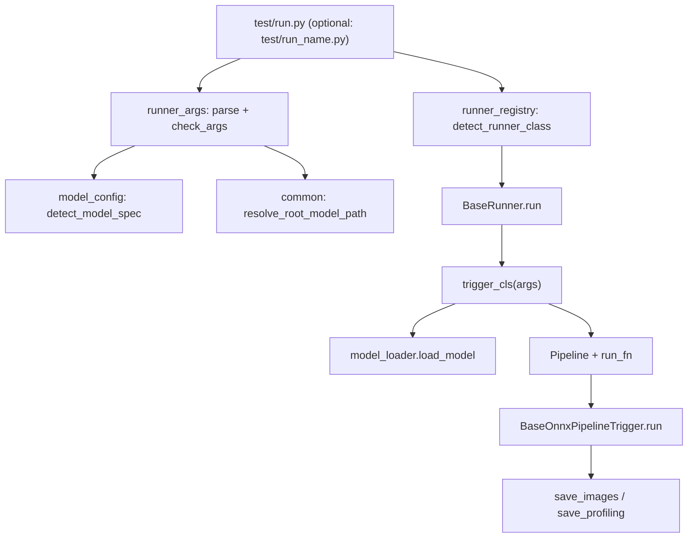

# GenAI-SD Developer Guide

**Audience:** engineers adding or maintaining ONNX/NPU pipelines in this repo.

**Read this when you need to:**
- plug in a new model family end-to-end
- understand why `test/run.py` picked a particular Runner
- debug routing, defaults, profiling, or save paths

**You will touch three layers** (Pipeline → Trigger → Runner) and **two registries** (`model_config` + `runner_registry`). The checklist in [Section 3](#3-checklist-for-a-new-pipeline) is the fastest path; [Section 4](#4-implementation-walkthrough) has the details.

> **Other docs**
> - Windows setup, drivers, model download → [docs/01-quick-start.md](01-quick-start.md)
> - Linux setup → [docs/05-linux-guide.md](05-linux-guide.md)
> - Inference (all models) → [docs/03-model-reference-guide.md](03-model-reference-guide.md)
> - Model optimization (DD/NPU) → [docs/04-model-generate-guide.md](04-model-generate-guide.md)
> - Batch benchmark orchestration → [ORCHESTRATOR_README.md](../ORCHESTRATOR_README.md)

---

## Table of Contents

1. [Overview](#1-overview)
2. [How a run works](#2-how-a-run-works)
3. [Checklist for a new pipeline](#3-checklist-for-a-new-pipeline)
4. [Implementation walkthrough](#4-implementation-walkthrough)
5. [Built-in pipelines](#5-built-in-pipelines)
6. [Registry rules](#6-registry-rules)
7. [CLI, env vars, and batch testing](#7-cli-and-batch-testing)
8. [Verify and debug](#8-verify-and-debug)
9. [Appendix](#9-appendix)

---

## 1. Overview

### 1.1 Mental model: three layers

Think of GenAI-SD as **CLI → load models → run diffusion → save files**. Code maps that to three folders:

| Layer | Path | Your job | Framework helps with |
|---|---|---|---|
| **Pipeline** | `src/pipeline/` | Implement the forward pass (scheduler, denoise, VAE, …) | Profiling hooks read `perf_time_dict` / `perf_time_gpu_model` from your pipeline instance |
| **Trigger** | `src/trigger/` | Load weights, construct the pipeline, call `super().run()` | `BaseOnnxPipelineTrigger` handles single run vs profiling loop |
| **Runner** | `src/runner/` | Map CLI args → Trigger; loop prompts × sizes; save PNG/Excel | `BaseRunner.run()` is the standard loop |

**Rule of thumb:** put **math and tensor flow** in Pipeline; put **file paths and `load_model()`** in Trigger; put **CLI and batching** in Runner.



### 1.2 Codebase glossary

| Term | Where | What it means in practice |
|---|---|---|
| Pipeline | `pipeline_*_onnx_amd.py` | Callable that runs one generation and returns images |
| Trigger | `*Trigger` | Owns loaded models; exposes `run(height, width, prompt, …)` |
| Runner | `*Runner` | Wires CLI to a Trigger via `trigger_cls` |
| `ModelSpec` | `model_config.py` | Default CLI values when flags are omitted |
| `RunnerSpec` | `runner_registry.py` | Routes `--model_id` (+ optional `--controlnet`) to a Runner class |
| `InferenceConfig` | `model_config.py` | Dataclass of those defaults (size, steps, prompt, paths, …) |
| `ModelLoadConfig` | passed to `load_model()` | Per-component path, `ModelType`, EP, DD flags |
| `ShapeContext` | `base_runner.py` | One `(height, width)` plus extras from dynamic-shape JSON |

### 1.3 Two registries = defaults + routing

Both registries are **ordered lists**. The first matching row wins. Matching is substring-based on lowercased `--model_id`, with an optional `--controlnet` filter.

| Registry | File | Function | Fixes problems like… |
|---|---|---|---|
| Defaults | `model_config.py` | `detect_model_spec()` | "Why is steps=8 / size=1024 when I didn't pass flags?" |
| Runner | `runner_registry.py` | `detect_runner_class()` | "Why did it load SDXL code for my SD3 model?" |

**When you add a pipeline, register both** with the **same** `model_ids` and `controlnet_filter`.

There is **no** Trigger registry. The Runner declares `trigger_cls = YourTrigger`.

---

## 2. How a run works

Use this section as a **debug trace** when something fails between CLI and saved PNG.

### 2.1 Entry points

**Auto-routing** — [`test/run.py`](../test/run.py) (the unified entry point for all models):

```python
runner_cls = detect_runner_class(
    args.model_id,
    getattr(args, "controlnet", None),
    runner_name=getattr(args, "runner", None),  # optional override
)
runner_cls(args).run()
```

**Pinned Runner** (optional dev convenience script, e.g. `test/run_sd.py`) — skip auto-routing
during active development. See [Section 4.6](#46-optional-dev-entry-testrun_namepy) for the pattern:

```python
SDRunner(args).run()
```

### 2.2 CLI: parse → validate → defaults

[`runner_args.py`](../src/utils/runner_args.py):

1. `parse_args()` — read flags.
2. `check_args()` — apply `ModelSpec` defaults, resolve/download `--model_path`, validate custom op DLL, output dir, etc.

If you add a flag: **parser → `check_args` → `get_trigger_kwargs` / `get_run_kwargs`**.

### 2.3 Runner loop

[`BaseRunner.run()`](../src/runner/base_runner.py):

```python
trigger = trigger_cls(args) 
for prompt_idx, prompt in enumerate(get_prompts(args)):
    for shape in get_shapes(args, default_extras=self.default_shape_extras):
        images = normalize_images(trigger.run(args, prompt, shape))
        save_images(args, images, width=..., height=..., ...)
        save_profiling(trigger, args, width=shape.width, height=shape.height, ...)
        # profiling key: h{height}_w{width}
```

`normalize_images()` accepts a bare image list or a tuple whose first element is the list—so Triggers should return **only images** (see [Trigger returns](#returns)).

### 2.4 Trigger: load once, run many times

Typical Trigger `run()`:

```python
pipe_obj = YourPipelineAMD(...)   # already loaded in __init__

def run_fn():
    return pipe_obj(prompt=..., height=..., width=..., ...)

return super().run(pipe_obj, run_fn, height, width, enable_profile=self.enable_profile)
```

[`BaseOnnxPipelineTrigger.run()`](../src/trigger/base_trigger.py):

| Mode | Behavior |
|---|---|
| Normal | One `run_fn()` call; logs wall time |
| `--enable_profile` | Warm-up + `profiling_rounds`; stores `ProfilingResult` under `pipeline_metrics["h{height}_w{width}"]` |

### 2.5 Outputs

| Output | Location | Notes |
|---|---|---|
| PNG | `generated_images/` (or `--output_path`) | Filename from `common.generate_filename()` |
| Profiling `.xlsx` | same folder | Only with `--enable_profile`; needs matching `h{height}_w{width}` key |

---

## 3. Checklist for a new pipeline

### 3.1 Minimum viable integration (7 steps)

Copy an existing family from [Section 4.1](#41-pick-a-template), then check off:

| # | Task | Files |
|---|---|---|
| 1 | **Pipeline** — forward pass + profiling dicts | `src/pipeline/pipeline_<name>_onnx_amd.py` |
| 2 | Export pipeline | `src/pipeline/__init__.py` |
| 3 | **Trigger** — `load_model` in `__init__`, `super().run` in `run()` | `src/trigger/<Name>Trigger.py` |
| 4 | Export trigger | `src/trigger/__init__.py` |
| 5 | **Runner** — set `trigger_cls`; override hooks only if needed | `src/runner/<name>_runner.py` |
| 6 | Register **Runner** (specific rules **above** generic) | `runner_registry.py` |
| 7 | Register **defaults** (same `model_ids` / `controlnet_filter`) | `model_config.py` |

**Pipeline profiling (if you use `--enable_profile`):**
- Maintain `perf_time_dict` (NPU) and `perf_time_gpu_model` (CPU)
- Optionally implement `_clear_time_dict()` after warm-up

**Pipeline return value:** `.images`, or a list, or a tuple whose first element is the image list.

### 3.2 Optional extras

| Need | What to add |
|---|---|
| New CLI flag | `runner_args.py` + pass through Runner kwargs |
| Dev script that skips auto-routing | `test/run_<name>.py` |
| Multiple sizes from JSON | `default_shape_extras` + `shape.extras` (see Flux) |
| ControlNet / img2img / outpainting | Often custom `Runner.run()` + Trigger preprocessing |
| Lower peak memory | Trigger `__enter__` / `__exit__` (Flux, SD3) |
| Orchestrator batch matrix | `config/pipeline_configs.yaml` |

---

## 4. Implementation walkthrough

### 4.1 Pick a template

Don't start from scratch—fork the closest family:

| Family | Trigger | Runner | Start here if… |
|---|---|---|---|
| SD 1.5 | [`StableDiffusionONNXPipelineTrigger`](../src/trigger/StableDiffusionONNXPipelineTrigger.py) | [`sd_runner`](../src/runner/sd_runner.py) | Single CLIP + UNet + VAE |
| SDXL | [`StableDiffusionXLONNXPipelineTrigger`](../src/trigger/StableDiffusionXLONNXPipelineTrigger.py) | [`sdxl_runner`](../src/runner/sdxl_runner.py) | Two CLIPs + img2img |
| Flux | [`FluxPipelineTrigger`](../src/trigger/FluxPipelineTrigger.py) | [`flux_runner`](../src/runner/flux_runner.py) | T5 on NPU + Transformer |
| FLUX.2 Klein | [`StableDiffusionFlux2KleinONNXPipelineTrigger`](../src/trigger/StableDiffusionFlux2KleinONNXPipelineTrigger.py) | [`flux2_klein_runner`](../src/runner/flux2_klein_runner.py) | Qwen3 encoder + image editing |
| SD3 / 3.5 | [`StableDiffusion3PipelineTrigger`](../src/trigger/StableDiffusion3PipelineTrigger.py) | [`sd3x_runner`](../src/runner/sd3x_runner.py) | MMDiT + `common/` + `normal/` layout |
| SD1.5 ControlNet | [`StableDiffusionControlnetONNXPipelineTrigger`](../src/trigger/StableDiffusionControlnetONNXPipelineTrigger.py) | [`sd15_controlnet_runner`](../src/runner/sd15_controlnet_runner.py) | Canny + custom `pipe.run()` |
| SD3 outpainting | [`StableDiffusion3ControlnetOutpaintingONNXPipelineTrigger`](../src/trigger/StableDiffusion3ControlnetOutpaintingONNXPipelineTrigger.py) | [`sd3x_outpainting_runner`](../src/runner/sd3x_outpainting_runner.py) | Mask padding + non-square save size |

### 4.2 Pipeline layer

**Files:** `pipeline_<family>_onnx_amd.py`  
**Classes:** `*PipelineAMD` (diffusers-style naming)

**Profiling:** populate timing lists on the pipeline instance; base Trigger averages them in `print_summary()`.

**Returns:** anything `_normalize_pipe_output()` accepts (see [Section 2.3](#23-runner-loop)).

### 4.3 Trigger layer

#### `__init__` checklist

```python
super().__init__(args)
self.root_model_path = args.model_path   # optional; profiling Excel
```

`BaseOnnxPipelineTrigger.__init__(args)` sets `self.model_id`, `self.enable_profile`,
`self.profiling_rounds`, `self.execution_providers`, and `self.load_metrics_collector`
automatically. No need to copy them manually.

For each component:

```python
load_model(
    ModelLoadConfig(model_path=..., model_type=..., ...),
    self.load_metrics_collector,  # records load time / memory / device
)
```

ONNX on NPU typically uses `replaced.onnx`; otherwise `model.onnx` (selected inside `model_loader`). See [Appendix A](#appendix-a-modeltype).

**VAE gotcha:** set `scaling_factor` if missing (black images otherwise):

```python
if "scaling_factor" not in self.vae_decoder.config:
    self.vae_decoder.config["scaling_factor"] = 0.18215
```

#### `run()` template

```python
def run(self, args, prompt: str, shape):
    height, width = shape.height, shape.width
    pipe_obj = YourPipelineAMD(...)
    common.print_config({...})

    def run_fn():
        g = torch.Generator().manual_seed(args.seed) if getattr(args, "seed", None) else torch.Generator()
        return pipe_obj(prompt=prompt, height=height, width=width, ...)

    return super().run(
        pipe_obj, run_fn, height, width,
        enable_profile=self.enable_profile,
    )
```

<a id="returns"></a>

**Returns:** return **only images** through the base class (a `list` of PIL/tensors).

If the **saved** image size ≠ CLI `height`/`width` (outpainting canvas is the usual case):
1. Store real dimensions on the Trigger, e.g. `self.origin_width`, `self.origin_height`.
2. In a custom Runner `run()`, pass those into `save_images()` after `normalize_images(trigger.run(...))`.

### 4.4 Runner layer

**Minimum:** only set `trigger_cls`. `BaseRunner.run()` calls `trigger_cls(args)` and
`trigger.run(args, prompt, shape)` directly — no `get_trigger_kwargs`/`get_run_kwargs` boilerplate.

Reference — [`sd_runner.py`](../src/runner/sd_runner.py):

```python
class SDRunner(BaseRunner):
    # Trigger reads args directly
    trigger_cls = StableDiffusionONNXPipelineAMDTrigger
```

**Override base hooks when** you need extra behaviour:

| Hook | When to override |
|---|---|
| `pre_run(args)` | Set default attrs on `args` before the loop (e.g. `args.controlnet`) |
| `get_save_dimensions(trigger, shape)` | Saved image size ≠ CLI size (e.g. outpainting canvas) |
| `run()` (full override) | ControlNet image prep, img2img extra step count, etc. |

**Dynamic shape extras (Flux pattern):**

```python
class FluxRunner(BaseRunner):
    trigger_cls = FluxPipelineTrigger
    default_shape_extras = {"txt_seq_len": 256}
    # Trigger reads shape.extras.get("txt_seq_len", 256) inside run(args, prompt, shape)
```

### 4.5 Register in both lists

**`model_config.py`** — defaults:

```python
register(ModelSpec(
    model_ids=["my-new-model", "my-new-model-amdnpu"],
    defaults=InferenceConfig(height=512, width=512, num_inference_steps=20, ...),
    controlnet_filter=None,  # must match RunnerSpec
))
```

SD3 ControlNet: consider `SD3ControlNetConfig` / `SD35ControlNetConfig` for pre-baked guidance scales.

**`runner_registry.py`** — routing:

```python
register(RunnerSpec(
    name="my_pipeline",
    runner_cls=MyRunner,
    model_ids=["my-new-model", "my-new-model-amdnpu"],
    controlnet_filter=None,
))
```

**Order matters** (most specific first):

1. Dedicated controlnet `model_id`s  
2. SD1.5 + `controlnet_filter="canny"`  
3. SD3 + `controlnet_filter="outpainting"`  
4. SD3 general  
5. Broad catch-alls (`flux`, `sdxl`, `sd15`, …)

### 4.6 Optional dev entry: `test/run_<name>.py`

```python
import os, sys
sys.path.insert(0, os.path.dirname(os.path.dirname(os.path.abspath(__file__))))

from src.runner import MyRunner
from src.utils import runner_args

if __name__ == "__main__":
    args = runner_args.parser.parse_args()
    runner_args.check_args(args)
    MyRunner(args).run()
```

---

## 5. Built-in pipelines

### 5.1 Registry map (9 pipelines)

| Runner | Registry `name` | Match when `model_id` contains | Needs `--controlnet` | Trigger |
|---|---|---|---|---|
| `SDRunner` | `sd15` | `stable-diffusion-v1-5`, `stable-diffusion-1.5`, `sd-turbo`, `stable-diffusion-2-1`, … | — | `StableDiffusionONNXPipelineAMDTrigger` |
| `SD15ControlnetRunner` | `sd15_controlnet` | `sd15-controlnet`, `sd1.5-controlnet-canny`, or SD1.5 + canny | `canny` | `StableDiffusionControlnetONNXPipelineTrigger` |
| `SDXLRunner` | `sdxl` | `sdxl-turbo`, `sdxl-base`, `playground-v2.5`, `dreamshaper-xl-lightning`, `ssd-1b`, `segmind-vega`, … | — | `StableDiffusionXLONNXPipelineAMDTrigger` |
| `FluxRunner` | `flux` | `flux.1-schnell`, `flux.1-dev`, `flux.1` | — | `FluxPipelineTrigger` |
| `Flux2KleinRunner` | `flux2_klein` | `flux.2-klein` | — | `StableDiffusionFlux2KleinONNXPipelineTrigger` |
| `SD3xRunner` | `sd3x` | `stable-diffusion-3-medium`, `stable-diffusion-3.5-medium`, … | — | `StableDiffusion3PipelineTrigger` |
| `SD3xOutpaintingRunner` | `sd3x_outpainting` | (same SD3 tokens) | `outpainting` | `StableDiffusion3ControlnetOutpaintingONNXPipelineTrigger` |

Pipeline modules live under `src/pipeline/pipeline_*_onnx_amd.py` (see table in repo).

### 5.2 Architectural differences

| Family | Encoders | Denoiser | Runner usually custom? |
|---|---|---|---|
| SD 1.5 | 1× CLIP | UNet | No |
| SDXL | 2× CLIP | UNet | Yes (img2img) |
| Flux | CLIP + T5 (NPU) | Transformer | No (uses `shape.extras`) |
| FLUX.2 Klein | Qwen3 (NPU) | Transformer | No (supports `--edit_image_path`) |
| SD1.5 ControlNet | CLIP | UNet + CN | Yes |
| SD3 / 3.5 | 2× CLIP + T5 | MMDiT | Sometimes (controlnet / tea) |
| SD3 outpainting | Same | Same | Yes (`origin_width` / `origin_height`) |

---

## 6. Registry rules

### 6.1 Matching algorithm

```
model_id_lower = model_id.lower()
for each spec in registration order:
    if any(token in model_id_lower for token in spec.model_ids):
        if spec.controlnet_filter is None OR matches args.controlnet:
            return spec   # first hit wins
```

### 6.2 Practical rules

| Do | Don't |
|---|---|
| Register **both** `ModelSpec` and `RunnerSpec` | Register only one and wonder why routing/defaults disagree |
| Put narrow rules **first** | Put `stable-diffusion-3.5` before `outpainting` filter |
| Use distinctive tokens (`stable-diffusion-3.5-medium`) | Use `"sd"` or `"3"` alone |
| Keep `controlnet_filter` identical in both files | Mismatch → right Runner, wrong defaults (or vice versa) |

### 6.3 Copy-paste example: SD 1.5

**Defaults** — [`model_config.py`](../src/utils/model_config.py):

```python
register(ModelSpec(
    model_ids=["stable-diffusion-v1-5", "stable-diffusion-1.5"],
    defaults=InferenceConfig(
        height=512, width=512,
        num_inference_steps=20, guidance_scale=7.5,
        prompt="Photo of a ultra realistic sailing ship, ...",
    ),
))
```

**Runner** — [`runner_registry.py`](../src/runner/runner_registry.py):

```python
register(RunnerSpec(
    name="sd15",
    runner_cls=SDRunner,
    model_ids=[
        "stable-diffusion-v1-5",
        "stable-diffusion-1.5",
        "sd-turbo",
        "stable-diffusion-2-1-base",
        "stable-diffusion-2-1",
    ],
))
```

---

## 7. CLI and batch testing

### 7.1 Flags you'll use daily

| Flag | Effect |
|---|---|
| `--model_id` | Download id + registry match |
| `--model_path` | Local weights root (auto-download if omitted) |
| `--revision` | Hugging Face branch, tag, or commit hash for model download (e.g. `"1.8.0"`) |
| `--controlnet` | Part of routing for SD3 / SD1.5 CN |
| `--width` / `--height` | Inference resolution |
| `--num_inference_steps` | Denoising steps |
| `--guidance_scale` | CFG |
| `--seed` | Random seed for reproducibility (`None` = non-deterministic) |
| `--prompt_2` | Second prompt for dual-encoder models (Flux T5 encoder) |
| `--t5_sequence_len` | T5 sequence length; passed via `shape.extras["t5_sequence_len"]` to SD3 Trigger |
| `--edit_image_path` | One or more reference image paths for FLUX.2 Klein image editing (`nargs="+"`) |
| `--enable_profile` | Warm-up + timed rounds + `.xlsx` |
| `--no_excel` | Skip `.xlsx` output (profiling metrics still printed to stdout) |
| `--no_images` | Skip PNG saving (pipeline still runs; for pure benchmarking) |
| `--dynamic_shape` + JSON path | Multiple `(height, width)` entries |
| `--output_path` | PNG / Excel output dir |
| `--custom_op_path` | `onnxruntime_providers_ryzenai.dll` / `libonnxruntime_providers_ryzenai.so` |

### 7.2 Environment variables

| Variable | Effect |
|---|---|
| `RYZENAI_GENAI_SD_MODELS_ROOT` | Override the model download/cache directory (default: `<project_root>/models/`). All `--model_id` auto-downloads and cache lookups use this path when set. |
| `ORT_DISABLE_GPU` | Set to `1` to force CPU-only execution providers (disables Ryzen AI EP). |
| `DISABLE_<COMPONENT>_DD` | Disable Dynamic Dispatch for a specific component (e.g. `DISABLE_UNET_DD=1`). |

### 7.3 Batch matrix (CI / benchmarks)

[`scripts/run_pipelines.py`](../scripts/run_pipelines.py) + [`config/pipeline_configs.yaml`](../config/pipeline_configs.yaml):

```yaml
my_pipeline:
  name: "My New Pipeline"
  width: 1024
  height: 1024
  model_ids:
    - "amd/my-new-model-amdnpu"
  extra_args:
    - "--num_inference_steps"
    - "20"
```

---

## 8. Verify and debug

### 8.1 Smoke commands

```bash
# After dual registration
python test/run.py --model_id "amd/<your-model>-amdnpu" --prompt "a test image"

# Pinned script while developing
python test/run_my.py --model_id "amd/<your-model>-amdnpu" --prompt "test"

# Profiling path
python test/run.py --model_id "amd/<your-model>-amdnpu" --enable_profile --prompt "test"
```

### 8.2 Integration checklist

- [ ] No `ValueError: No runner matched model_id=...`
- [ ] Defaults look right (or you accept the fallback `ModelSpec`)
- [ ] PNG under `generated_images/`
- [ ] Profiling: `.xlsx` + performance table in logs
- [ ] Load logs: expected components on NPU vs CPU

### 8.3 Troubleshooting

| Symptom | Likely cause | Fix |
|---|---|---|
| Wrong Runner | `RunnerSpec` too low / token too broad | Move your spec up; use longer `model_ids` tokens |
| Wrong default steps/size | Missing or late `ModelSpec` | Add or reorder `ModelSpec` |
| `No profiling result for key` | `height`/`width` mismatch | Profiling key is `h{height}_w{width}` from the shape loop |
| NPU load error | DLL / DD / missing `replaced.onnx` | `--custom_op_path`, env vars, model tree layout |
| All-black output | Missing VAE `scaling_factor` | Set in Trigger `__init__` |
| Outpainting save size wrong | Using CLI size instead of canvas | Read `trigger.origin_width/height` in Runner |

---

## 9. Appendix

### Appendix A: `ModelType`

[`model_loader.py`](../src/utils/model_loader.py):

| `ModelType` | Components |
|---|---|
| `ONNX_MODEL` | UNet, VAE, ControlNet, Transformer |
| `T5_NPU_MODEL` | T5 on NPU |
| `CLIP_TEXT_MODEL` | CLIP text encoder |
| `CLIP_TEXT_WITH_PROJECTION` | SDXL second encoder |
| `CLIP_TOKENIZER` | CLIP tokenizer |
| `T5_TOKENIZER` | T5 tokenizer |
| `QWEN2_TOKENIZER` | Qwen2 tokenizer (FLUX.2 Klein) |
| `SCHEDULER` | Scheduler config |
| `CLIP_IMAGE_PROCESSOR` | ControlNet image processor |
| `AUTO_TOKENIZER` | Generic tokenizer |

```python
from src.utils.model_loader import ModelLoadConfig, ModelType, load_model

self.unet = load_model(
    ModelLoadConfig(
        model_path=os.path.join(root_model_path, "unet"),
        model_type=ModelType.ONNX_MODEL,
        disable_dd_env="DISABLE_UNET_DD",
        custom_op_path=custom_op_path,
        enable_compile=enable_compile,
        execution_providers=self.execution_providers,
    ),
    self.load_metrics_collector,
)
```

### Appendix B: Naming conventions

| Piece | File | Class |
|---|---|---|
| Pipeline | `pipeline_<family>_onnx_amd.py` | `*PipelineAMD` |
| Trigger | `<Name>Trigger.py` | `*Trigger` |
| Runner | `<name>_runner.py` | `<Name>Runner` |
| Test entry | `test/run_<name>.py` | — |

### Appendix C: SD 1.5 reference snippet

[`StableDiffusionONNXPipelineTrigger`](../src/trigger/StableDiffusionONNXPipelineTrigger.py) — load + run:

```python
self.tokenizer = load_model(
    ModelLoadConfig(
        model_path=os.path.join(root_model_path, "tokenizer"),
        model_type=ModelType.CLIP_TOKENIZER,
    ),
    self.load_metrics_collector,
)
# ... unet, vae_decoder, etc.

return super().run(pipe_obj, _run, height, width, enable_profile=self.enable_profile)
```

### Appendix D: File index

| I need to change… | Open |
|---|---|
| CLI flags / validation | `src/utils/runner_args.py` |
| Default hyperparameters | `src/utils/model_config.py` |
| Which Runner runs | `src/runner/runner_registry.py` |
| Prompt × size loop | `src/runner/base_runner.py` |
| Profiling / `super().run()` | `src/trigger/base_trigger.py` |
| `load_model()` | `src/utils/model_loader.py` |
| Download / paths / filenames | `src/utils/common.py` |
| Auto entry | `test/run.py` |
| Batch YAML | `config/pipeline_configs.yaml` |

---

*When you change registry entries, update [Section 5](#5-built-in-pipelines) and [Section 6](#6-registry-rules) so the next developer isn't surprised.*
